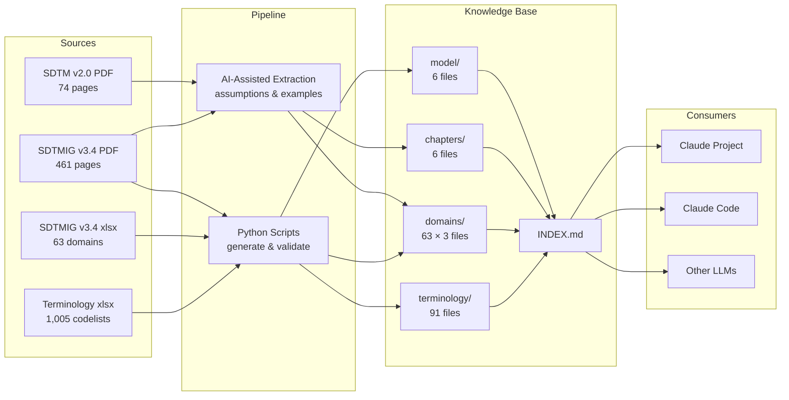

<a id="top"></a>

<div align="center">

<a href="https://git.io/typing-svg">
  
</a>

<p><strong>Turn unreadable PDFs into an AI-ready, instantly searchable SDTM knowledge base.</strong></p>

[](https://creativecommons.org/licenses/by/4.0/)
[](https://www.cdisc.org/standards/foundational/sdtmig)
[](https://www.cdisc.org/standards/foundational/sdtm)
[](knowledge_base/domains/)
[](knowledge_base/)
[](knowledge_base/terminology/)
[](knowledge_base/terminology/)

[English](README.md) | [中文](README_CN.md)

</div>

---

## About

CDISC SDTM standards are locked inside dense PDFs and sprawling Excel files — hard to search, hard to cross-reference, and nearly impossible for AI to use reliably.

**SDTM Pedia** converts these source documents into **293 structured Markdown content files** (plus `INDEX.md` / `ROUTING.md` / `VARIABLE_INDEX.md` for navigation), organized by domain, terminology, and conceptual model. The result is a knowledge base that both humans and AI can navigate instantly — no vector database required.

> **How can you trust an AI-extracted knowledge base?** See [METHODOLOGY.md](METHODOLOGY.md) — sources, traceability, the two issues we caught and fixed during validation, and how to spot-check any answer against the source PDF.

## Features

| Feature | Description |
|---------|-------------|
| **PDF → Markdown** | Transforms 535+ pages of SDTM PDF specifications into structured, searchable Markdown |
| **63 Domains** | Every SDTM IG v3.4 domain covered with `spec.md` + `assumptions.md` + `examples.md` |
| **37,939 Terms** | Complete CDISC Controlled Terminology — 1,005 codelists, fully indexed |
| **AI-Ready** | Designed as a knowledge base for LLMs — works directly with Claude Projects, Cursor, etc. |
| **Zero Infrastructure** | No vector database, no embedding pipeline — just files and directory structure |
| **Independently Verified** | Atom-level audit against the source PDF — 99.02% coverage, 0 hallucinated atoms |

## Architecture



## Ecosystem

| Piece | Where | What it is |
|-------|-------|------------|
| **Knowledge base** | [`knowledge_base/`](knowledge_base/) (this repo) | 293 content files + 3 navigation indexes — the product |
| **Website** | [sdtm-pedia.pages.dev](https://sdtm-pedia.pages.dev/) | User guide, platform comparison and deployment tutorials (zh / en / ja), built from [`web/`](web/) |
| **Release bundles** | [GitHub Releases](https://github.com/hakupao/sdtm-pedia/releases) — v1.0, v1.1, v1.4 | Per-platform zips (Claude Projects, ChatGPT GPTs, Gemini Gems, NotebookLM); sources in [`releases/`](releases/) |
| **Q&A service** | [hakupao/sdtm-rag](https://github.com/hakupao/sdtm-rag) | RAG + knowledge-graph Q&A service built on this knowledge base (pins it as a git submodule). A public demo is planned; the link will be added here once it is live. |

## How to Use the Knowledge Base

- **On an AI platform** — use a hosted instance or self-deploy a release bundle; see [Quick Start](#quick-start).
- **As plain Markdown** — point Claude Code, Cursor or any file-aware LLM at `knowledge_base/`. Start from `INDEX.md`, then `ROUTING.md` (question → file) and `VARIABLE_INDEX.md` (variable → domain).
- **Read it yourself** — every domain folder has `spec.md` (variables), `assumptions.md` (business rules) and `examples.md` (worked data examples).

## Quality & Verification

How the knowledge base was built and checked is documented in [METHODOLOGY.md](METHODOLOGY.md): authoritative sources, construction pipeline, how to audit a single answer against the source PDF, and the non-conformances found and closed.

A separate literal-level audit compared the knowledge base atom by atom with the source PDF. Final figures, from [`archive/deep_verification/RETROSPECTIVE.md`](archive/deep_verification/RETROSPECTIVE.md):

| Metric | Value |
|--------|-------|
| PDF atoms extracted | 12,487 |
| Knowledge-base atoms | 10,435 |
| Coverage (adjusted denominator) | 99.02% |
| Atoms judged HALLUCINATED | 0 |
| Issues found and repaired | 12 (Issues 5–16) |
| Content error rate in final spot-check | 3.3% (2/60) |

Per-batch evidence is in [`archive/deep_verification/evidence/checkpoints/`](archive/deep_verification/evidence/checkpoints/).

## Project Structure

```
sdtm-pedia/
├── knowledge_base/              # The knowledge base (293 content files + 3 indexes)
│   ├── INDEX.md                 # Master index — navigation entry point
│   ├── model/                   # SDTM v2.0 conceptual model (6 files)
│   │   ├── concepts_and_terms.md
│   │   ├── observation_classes.md
│   │   ├── special_purpose_domains.md
│   │   ├── associated_persons.md
│   │   ├── study_level_data.md
│   │   └── relationship_datasets.md
│   ├── chapters/                # SDTMIG v3.4 general chapters (6 files)
│   │   ├── ch01_introduction.md
│   │   ├── ch02_fundamentals.md
│   │   ├── ch03_submitting_data.md
│   │   ├── ch04_general_assumptions.md
│   │   ├── ch08_relationships.md
│   │   └── ch10_appendices.md
│   ├── domains/                 # 63 domains × 3 files each
│   │   ├── AE/
│   │   │   ├── spec.md          # Variable specification table
│   │   │   ├── assumptions.md   # Domain-specific business rules
│   │   │   └── examples.md      # Implementation examples with data
│   │   ├── CM/
│   │   ├── DM/
│   │   ├── LB/
│   │   └── ...                  # 63 domains total
│   ├── terminology/             # CDISC Controlled Terminology (91 files)
│   │   ├── core/                # Core codelists (42 files)
│   │   ├── questionnaires/      # Questionnaire codelists (43 files)
│   │   └── supplementary/       # Supplementary codelists (6 files)
│   ├── ROUTING.md               # Query routing index (Phase 6.1)
│   └── VARIABLE_INDEX.md        # Variable-level reverse index (Phase 6.3)
│
├── releases/v1.{0,1,2,3,4}/     # Self-contained platform release bundles (latest: v1.4, 2026-05-22)
├── web/                         # Astro website (prod: sdtm-pedia.pages.dev)
├── tools/                       # build_release.sh (bundles + manifest), check_links.py
├── docs/                        # PROGRESS.md, TRACEABILITY.md, PATH_MAP.md (old → new paths)
│
├── archive/                     # Closed work tracks (read-only)
│   ├── deep_verification/       # PDF→KB literal-level audit — COMPLETE (coverage 99.02%)
│   ├── ai_platforms/            # 4-platform AI deployment workspace (CLOSED)
│   ├── jp_delivery/             # Japanese delivery documents (CLOSED)
│   └── legacy/                  # Superseded v0 knowledge base + legacy logs
│
├── .work/                       # Process records: plans, verification, work logs, change chains
│
├── METHODOLOGY.md · DISCLAIMER.md · LICENSE (CC BY 4.0)
└── source/                      # CDISC source PDFs/xlsx — local only, not redistributed
```

## Domain Coverage

<details>
<summary><b>Special-Purpose Domains (5)</b></summary>

| Domain | Name |
|--------|------|
| CO | Comments |
| DM | Demographics |
| SE | Subject Elements |
| SM | Subject Disease Milestones |
| SV | Subject Visits |

</details>

<details>
<summary><b>Interventions Domains (7)</b></summary>

| Domain | Name |
|--------|------|
| AG | Procedure Agents |
| CM | Concomitant/Prior Medications |
| EC | Exposure as Collected |
| EX | Exposure |
| ML | Meal Data |
| PR | Procedures |
| SU | Substance Use |

</details>

<details>
<summary><b>Events Domains (7)</b></summary>

| Domain | Name |
|--------|------|
| AE | Adverse Events |
| BE | Biospecimen Events |
| CE | Clinical Events |
| DS | Disposition |
| DV | Protocol Deviations |
| HO | Healthcare Encounters |
| MH | Medical History |

</details>

<details>
<summary><b>Findings Domains (32)</b></summary>

| Domain | Name |
|--------|------|
| BS | Biospecimen Findings |
| CP | Cell Phenotype Findings |
| CV | Cardiovascular System Findings |
| DA | Product Accountability |
| DD | Death Details |
| EG | ECG Test Results |
| FA | Findings About Events or Interventions |
| FT | Functional Tests |
| GF | Genomics Findings |
| IE | Inclusion/Exclusion Criteria Not Met |
| IS | Immunogenicity Specimen Assessments |
| LB | Laboratory Test Results |
| MB | Microbiology Specimen |
| MI | Microscopic Findings |
| MK | Musculoskeletal System Findings |
| MS | Microbiology Susceptibility |
| NV | Nervous System Findings |
| OE | Ophthalmic Examinations |
| PC | Pharmacokinetics Concentrations |
| PE | Physical Examination |
| PP | Pharmacokinetics Parameters |
| QS | Questionnaires |
| RE | Respiratory System Findings |
| RP | Reproductive System Findings |
| RS | Disease Response and Clin Classification |
| SC | Subject Characteristics |
| SR | Skin Response |
| SS | Subject Status |
| TR | Tumor/Lesion Results |
| TU | Tumor/Lesion Identification |
| UR | Urinary System Findings |
| VS | Vital Signs |

</details>

<details>
<summary><b>Trial Design Domains (7)</b></summary>

| Domain | Name |
|--------|------|
| TA | Trial Arms |
| TD | Trial Disease Assessments |
| TE | Trial Elements |
| TI | Trial Inclusion/Exclusion Criteria |
| TM | Trial Disease Milestones |
| TS | Trial Summary |
| TV | Trial Visits |

</details>

<details>
<summary><b>Relationship & Study Reference Domains (5)</b></summary>

| Domain | Name |
|--------|------|
| OI | Non-host Organism Identifiers |
| RELREC | Related Records |
| RELSPEC | Related Specimens |
| RELSUB | Related Subjects |
| SUPPQUAL | Supplemental Qualifiers |

</details>

## Quick Start

### Use the hosted instances (no setup)

Pre-built instances you can open and use right away — no install, no API key. Sign-in to the host platform may be required.

| Platform | Direct link |
|----------|-------------|
| **ChatGPT GPT** | [Open ↗](https://chatgpt.com/g/g-69e635b99e848191a2818cd8e8e7e9cc-sdtm-knowledge-base) |
| **Gemini Gem** | [Open ↗](https://gemini.google.com/gem/10HcbqLoT3UxTj0O63M8qgPHpMxGNkHay?usp=sharing) |
| **NotebookLM** | [Open ↗](https://notebooklm.google.com/notebook/2cebc5cb-1466-4788-9474-bdf2d75d2060) |

> Claude Projects cannot be shared by link — to use it, deploy your own via Option A below.

### Option A — Self-deploy on a hosted AI platform (recommended)

A turn-key release bundle for **4 platforms** (Claude Projects, ChatGPT GPTs, Gemini Gems, NotebookLM) ships at [`releases/v1.4/`](releases/v1.4/) (latest, 2026-05-22); the same bundles are downloadable as zips from [GitHub Releases](https://github.com/hakupao/sdtm-pedia/releases). Each platform sub-directory is self-contained: system prompt + uploads + step-by-step tutorial in 3 languages (zh/en/ja). Earlier releases (`releases/v1.{0,1,2,3}/`) remain immutable for reference. Note: **Gemini is MAINTAINED_NO_SANITY_TEST from v1.4 onwards** — bundle still ships, but sanity testing was discontinued; users self-verify.

1. **Clone the repo** (or download a platform zip from GitHub Releases)
   ```bash
   git clone https://github.com/hakupao/sdtm-pedia.git
   cd sdtm-pedia/releases/v1.4
   ```

2. **Pick a platform** — Read `README.en.md` and `PLATFORM_COMPARISON.en.md` (capacity, sharing, audio overview, etc.)

3. **Follow the tutorial** under `self_deploy/<platform>/tutorial.en.md` — all upload files and prompts are co-located in the same directory

4. **Verify with the demo question set** in `DEMO_QUESTIONS.md` (10 questions × 3 languages, expected answers included)

> See `USER_GUIDE.en.md` for the consumer-side overview, `KNOWN_LIMITATIONS.en.md` for caveats, and `CHANGELOG.md` for release history.

### Option B — Use with Claude Code

Point Claude Code at the `knowledge_base/` directory — it will use `INDEX.md` + `ROUTING.md` + `VARIABLE_INDEX.md` to navigate and read relevant files on demand.

```
What Required variables does AE have?
How should DM's RFSTDTC be populated?
Which codelist is SEX bound to?
```

### Option C — Use with Other LLMs

The knowledge base is plain Markdown — it works with any LLM that supports file-based context (Cursor, Windsurf, GitHub Copilot, etc.).

## Source Documents

| Document | Version | Content |
|----------|---------|---------|
| SDTM Implementation Guide | v3.4 | 461 pages — domain specs, assumptions, examples |
| SDTM (Study Data Tabulation Model) | v2.0 Final (2021-11-29) | 74 pages — conceptual model |
| SDTMIG v3.4 xlsx | — | 1,917 variables across 63 domains |
| SDTM Terminology xlsx | — | 1,005 codelists / 37,939 terms |

## Roadmap

- [x] Phase 1 — xlsx auto-generation (spec.md + terminology)
- [x] Phase 2 — PDF page indexing
- [x] Phase 3 — PDF batch extraction (assumptions + examples)
- [x] Phase 4 — Supplementary content (model + chapters)
- [x] Phase 5 — Validation & INDEX.md
- [x] Phase 6.1 — Query routing index (`knowledge_base/ROUTING.md`)
- [x] Phase 6.2 — Cross-references between domains (in `spec.md` of each domain)
- [x] Phase 6.3 — Variable-level reverse index (`knowledge_base/VARIABLE_INDEX.md`, 1,523 variables)
- [x] Phase 6.5 — Multi-platform AI deployment + Releases v1.0 → v1.4 (4 platforms, latest at `releases/v1.4/`; Gemini MAINTAINED_NO_SANITY_TEST from v1.4)
- [x] Deep verification — literal-level PDF→KB atom-by-atom audit (COMPLETE: P1–P7, coverage 99.02%, see [Quality & Verification](#quality--verification))
- [x] Phase 7 — RAG Q&A + knowledge graph service: moved to [hakupao/sdtm-rag](https://github.com/hakupao/sdtm-rag) (see [Ecosystem](#ecosystem))

## Disclaimer

The knowledge base content is derived from CDISC published standards. **CDISC** is a registered trademark of the Clinical Data Interchange Standards Consortium. This project is **NOT** affiliated with, endorsed by, or sponsored by CDISC.

- The original CDISC source files (PDFs/xlsx) are **NOT** included in this repository due to copyright restrictions
- This knowledge base should **NOT** be considered a substitute for official CDISC publications
- For regulatory submissions, always refer to the original CDISC standards

For the full disclaimer, see [DISCLAIMER.md](DISCLAIMER.md).

## License

This work is licensed under a [Creative Commons Attribution 4.0 International License](https://creativecommons.org/licenses/by/4.0/). This license applies only to the original structuring and formatting work — the underlying standard definitions remain the intellectual property of CDISC.

## Acknowledgements

- [CDISC](https://www.cdisc.org/) — For developing and publishing the SDTM standards
- [Claude](https://claude.ai/) — AI-assisted extraction and validation pipeline

---

<div align="center">

[](https://star-history.com/#hakupao/sdtm-pedia)

<a href="https://github.com/hakupao/sdtm-pedia/graphs/contributors">
  
</a>

<br/>

**If this project helps your SDTM work, a star would be appreciated!**

</div>

<p align="right">(<a href="#top">back to top</a>)</p>
