# TA — Examples

The core of the Trial Design Model is the TA dataset. For each arm of the trial, the TA dataset contains 1 record for each occurrence of an element in the path of the arm.

Although the TA dataset has 1 record for each trial element traversed by subjects assigned to the arm, it is generally more useful to work out the overall design of the trial at the study cell level first, then to work out the elements within each study cell, and finally to develop the definitions of the elements that are contained in the Trial Elements (TE) table.

When working out the design of a trial, it is generally useful to draw diagrams such as those mentioned in ICH E3. The protocol may include a diagram that can serve as a starting point. Such a diagram can then be converted into a trial design matrix that displays the study cells and which in turn can be converted into the TA dataset.

This section uses example trials of increasing complexity to illustrate the concepts of trial design. For each example trial, the process of working out the TA table is illustrated by means of a series of diagrams and tables, including:

- A diagram showing the branching structure of the trial in a “study schema” format such as might appear in a protocol
- A diagram that shows the “prospective” view of the trial (i.e., the view of those participating in the trial). This is similar to the study schema view in that it usually shows a single pool of subjects at the beginning of the trial, with the pool of subjects being split into separate treatment groups at randomizations and other branches. Such diagrams include the epochs of the trial, and, for each group of subjects and each epoch, the sequence of elements within each epoch for that treatment group. The arms are also indicated on these diagrams.
- A diagram that shows the “retrospective” view of the trial (i.e., the view of the analyst reporting on the trial). This style of diagram looks more like a matrix; it is also more like the structure of the TA dataset. The retrospective view is arm-centered and shows, for each study cell (epoch/arm combination) the sequence of elements within that study cell. It can be thought of as showing, for each arm, the elements traversed by a subject who completed that arm as intended.
- If the trial is blinded, a diagram that shows the trial as it appears to a blinded participant
- A trial design matrix, an alternative format for representing most of the information in the diagram that shows arms and epochs, and which emphasizes the study cells
- The TA dataset

Example 1 should be reviewed before reading other examples, as it explains the conventions used for all diagrams and tables in the examples.

## Example 1

> KB note (not in SDTMIG): A simple parallel trial with 3 arms (Placebo, Drug A, Drug B), 3 epochs (Screening, Run-In, Treatment). Each study cell contains exactly 1 element. Randomization occurs at the end of the Run-In element.

Diagrams that represent study schemas generally conceive of time as moving from left to right, using horizontal lines to represent periods of time and slanting lines to represent branches into separate treatments, convergence into a common follow-up, or crossover to a different treatment.

In this type of document, diagrams are drawn using "blocks" corresponding to trial elements rather than horizontal lines. Trial elements are the various treatment and non-treatment time periods of the trial and we want to emphasize the separate trial elements might otherwise be "hidden" in a single horizontal line. See Section 7.2.2, Trial Elements (TE), for more information about defining trial elements. In general, the elements of a trial will be fairly clear. However, in the process of working out a trial design, alternative definitions of trial elements may be considered, in which case diagrams for each alternative may be constructed.

In the study schema diagrams in this example, the only slanting lines used are those that represent branches (i.e., decision points where subjects are divided into separate treatment groups). One advantage of this style of diagram, which does not show convergence of separate paths into a single block, is that the number of arms in the trial can be determined by counting the number of parallel paths at the right end of the diagram.

As illustrated in the study schema diagram for Example Trial 1, this simple parallel trial has 3 arms, corresponding to the 3 possible left-to-right "paths" through the trial. Each path corresponds to 1 of the 3 treatment elements at the right end of the diagram. Randomization is represented by the 3 red arrows leading from the Run-in block.

**Study Schema**

> KB note (not in SDTMIG): the following Mermaid diagram is a KB rendering of the PDF figure "Example Trial 1, Parallel Design Study Schema".

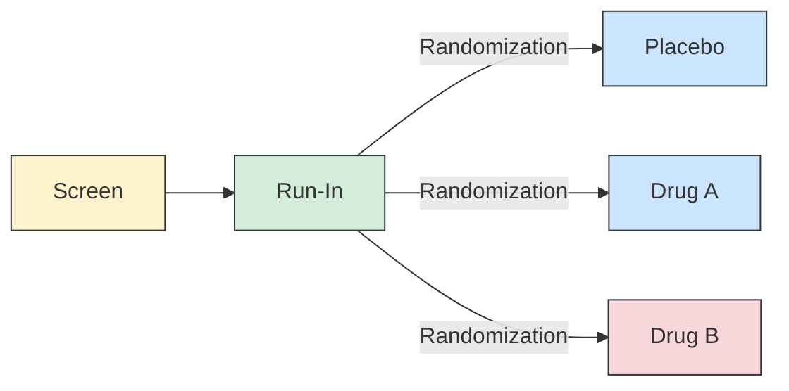

The next diagram for this trial shows the 3 epochs of the trial, indicates the 3 arms, and shows the sequence of elements for each group of subjects in each epoch. The arrows are at the right side of the diagram because it is at the end of the trial that all the separate paths through the trial can be seen. Note that, in this diagram, randomization—which was shown using 3 red arrows connecting the Run-in block with the 3 treatment blocks in the first diagram—is indicated by a note with an arrow pointing to the line between 2 epochs.

**Prospective View**

> KB note (not in SDTMIG): the following Mermaid diagram is a KB rendering of the PDF figure "Example Trial 1, Parallel Design Prospective View".

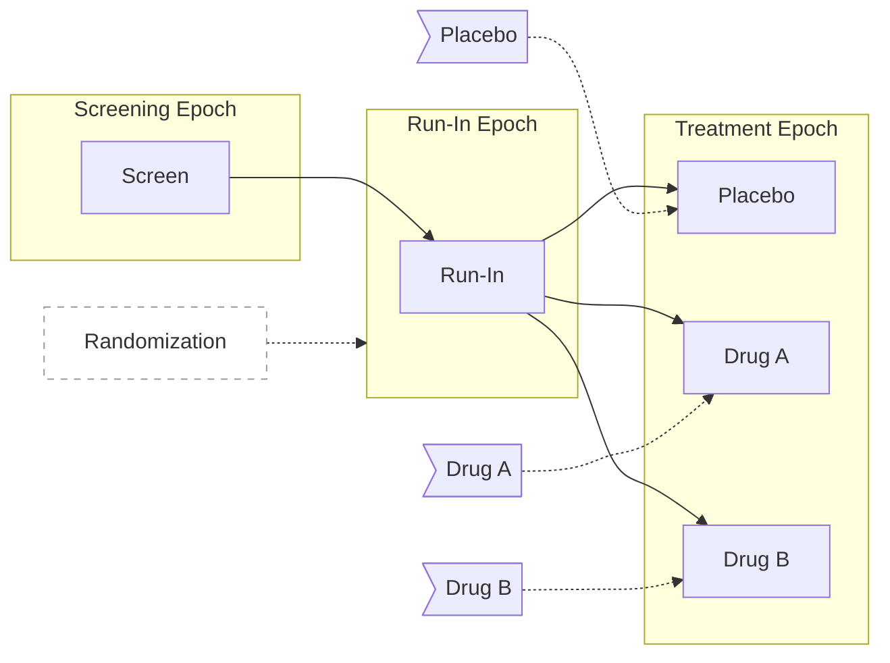

The next diagram can be thought of as the retrospective view of a trial, the view back from a point in time when a subject’s assignment to an arm is known. In this view, the trial appears as a grid, with an arm represented by a series of study cells, one for each epoch, and a sequence of elements within each study cell. In this example (as in many trials), there is exactly 1 element in each study cell. Later examples will illustrate that this is not always the case.

**Retrospective View**

> KB note (not in SDTMIG): the following Mermaid diagram is a KB rendering of the PDF figure "Example Trial 1, Parallel Design Retrospective View".

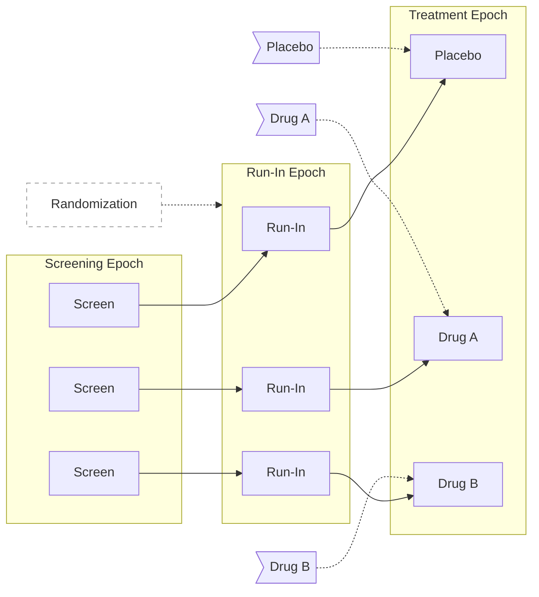

The next diagram shows the trial from the viewpoint of blinded participants. To blinded participants in this trial, all arms look alike. They know when a subject is in the screen element or the run-in element, but when a subject is in the treatment epoch, participants know only that the subject is receiving a study drug, not which study drug, and therefore not which element.

**Blinded View**

> KB note (not in SDTMIG): the following Mermaid diagram is a KB rendering of the PDF figure "Example Trial 1, Parallel Design Blinded View".

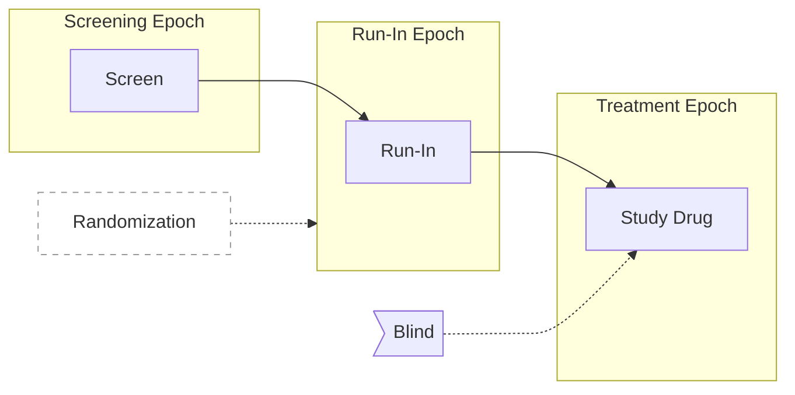

A trial design matrix is a table with a row for each arm in the trial and a column for each epoch in the trial. It is closely related to the retrospective view of the trial, and many users may find it easier to construct a table than to draw a diagram. The cells in the matrix represent the study cells, which are populated with trial elements. In this trial, each study cell contains exactly 1 element.

As illustrated in the following table, the columns of a trial design matrix are the epochs of the trial, the rows are the arms of the trial, and the cells of the matrix (the study cells) contain elements. Note that randomization is not represented in the trial design matrix. All of the preceding diagrams and the trial design matrix are alternative representations of the trial design. None of them contains all the information that will be in the finished TA dataset; users may find it useful to draw some or all of these diagrams when working out the dataset.

**Trial Design Matrix**

|  | Screen | Run-in | Treatment |
|---|---|---|---|
| **Placebo** | Screen | Run-in | PLACEBO |
| **A** | Screen | Run-in | DRUG A |
| **B** | Screen | Run-in | DRUG B |

For Example Trial 1, the conversion of the trial design matrix into the TA dataset is straightforward. For each cell of the matrix, there is a record in the TA dataset. ARM, EPOCH, and ELEMENT can be populated directly from the matrix. TAETORD acts as a sequence number for the elements within an arm, so it can be populated by counting across the cells in the matrix. The randomization information, which is not represented in the trial design matrix, is held in TABRANCH in the TA dataset. TABRANCH is populated only if there is a branch at the end of an element for the arm. When TABRANCH is populated, it describes how the decision at the branch point would result in a subject being in this arm.

**ta.xpt**

| Row | STUDYID | DOMAIN | ARMCD | ARM | TAETORD | ETCD | ELEMENT | TABRANCH | TATRANS | EPOCH |
|-----|---------|--------|-------|-----|---------|------|---------|----------|---------|-------|
| 1 | EX1 | TA | P | Placebo | 1 | SCRN | Screen | | | SCREENING |
| 2 | EX1 | TA | P | Placebo | 2 | RI | Run-In | Randomized to Placebo | | RUN-IN |
| 3 | EX1 | TA | P | Placebo | 3 | P | Placebo | | | TREATMENT |
| 4 | EX1 | TA | A | A | 1 | SCRN | Screen | | | SCREENING |
| 5 | EX1 | TA | A | A | 2 | RI | Run-In | Randomized to Drug A | | RUN-IN |
| 6 | EX1 | TA | A | A | 3 | A | Drug A | | | TREATMENT |
| 7 | EX1 | TA | B | B | 1 | SCRN | Screen | | | SCREENING |
| 8 | EX1 | TA | B | B | 2 | RI | Run-In | Randomized to Drug B | | RUN-IN |
| 9 | EX1 | TA | B | B | 3 | B | Drug B | | | TREATMENT |

## Example 2

> KB note (not in SDTMIG): Each arm represents a different order of treatments.

The following diagram for a crossover trial does not use the crossing slanted lines sometimes used to represent crossover trials, because the order of the blocks is sufficient to represent the design of the trial. Slanted lines are used only to represent the branch point at randomization, when a subject is assigned to a sequence of treatments. As in most crossover trials, the arms are distinguished by the order of treatments, with the same treatments present in each arm. Note that even though all 3 arms of this trial end with the same block (i.e., the block for the follow-up element), the diagram does not show the arms converging into one block. Also note that the same block (the “rest” element) occurs twice within each arm. Elements are conceived of as “reusable” and can appear in more than 1 arm, in more than 1 epoch, and more than once in an arm.

**Study Schema**

> KB note (not in SDTMIG): the following Mermaid diagram is a KB rendering of the PDF figure "Example Trial 2, Crossover Trial Study Schema".

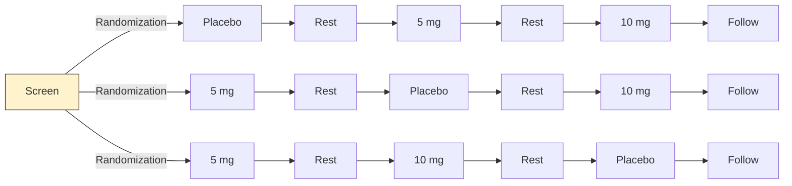

The next diagram for this crossover trial shows the prospective view of the trial; it identifies the epoch and arms of the trial, and gives each a name. As for most crossover studies, the objectives of the trial will be addressed by comparisons between the arms and by within-subject comparisons between treatments. Because the design depends on differentiating the periods during which the subject receives the 3 different treatments, there are 3 different treatment epochs. The fact that the rest periods are identified as separate epochs suggests that these also play an important part in the design of the trial; they are probably designed to allow subjects to return to “baseline,” with data collected to show that this occurred. Note that epochs are not considered reusable; each epoch has a different name, even though all the treatment epochs are similar and both the rest epochs are similar. As with the first example trial, there is a one-to-one relationship between the epochs of the trial and the elements in each arm.

**Prospective View**

> KB note (not in SDTMIG): the following Mermaid diagram is a KB rendering of the PDF figure "Example Trial 2, Crossover Trial Prospective View".

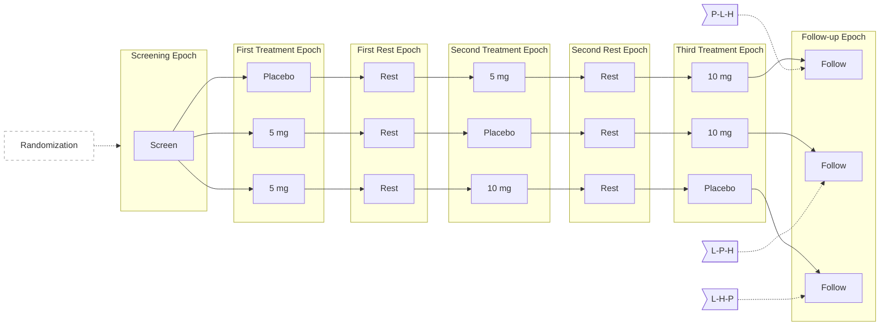

The next diagram shows the retrospective view of the trial.

**Retrospective View**

> KB note (not in SDTMIG): the following Mermaid diagram is a KB rendering of the PDF figure "Example Trial 2, Crossover Trial Retrospective View".

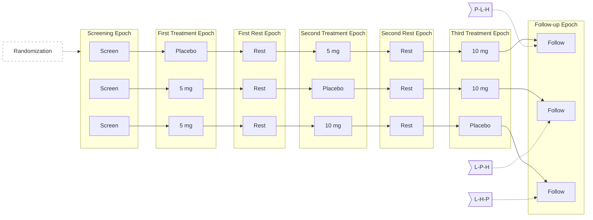

The last diagram for this trial shows the trial from the viewpoint of blinded participants. As in the simple parallel trial in Example Trial 1, blinded participants see only 1 sequence of elements; during the treatment epochs they do not know which of the treatment elements a subject is in.

**Blinded View**

> KB note (not in SDTMIG): the following Mermaid diagram is a KB rendering of the PDF figure "Example Trial 2, Crossover Trial Blinded View".

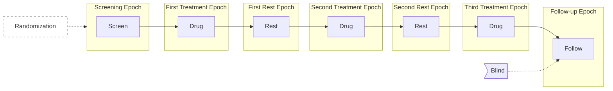

The following table illustrates the trial design matrix for this crossover example trial. It corresponds closely to the preceding retrospective diagram.

**Trial Design Matrix**

|  | Screen | First Treatment | First Rest | Second Treatment | Second Rest | Third Treatment | Follow-up |
|---|---|---|---|---|---|---|---|
| **P-5-10** | Screen | Placebo | Rest | 5 mg | Rest | 10 mg | Follow-up |
| **5-P-10** | Screen | 5 mg | Rest | Placebo | Rest | 10 mg | Follow-up |
| **5-10-P** | Screen | 5 mg | Rest | 10 mg | Rest | Placebo | Follow-up |

It is straightforward to produce the TA dataset for this crossover trial from the diagram showing arms and epochs, or from the trial design matrix.

**ta.xpt**

| Row | STUDYID | DOMAIN | ARMCD | ARM | TAETORD | ETCD | ELEMENT | TABRANCH | TATRANS | EPOCH |
|-----|---------|--------|-------|-----|---------|------|---------|----------|---------|-------|
| 1 | EX2 | TA | P-5-10 | Placebo-5mg-10mg | 1 | SCRN | Screen | Randomized to Placebo - 5 mg - 10 mg | | SCREENING |
| 2 | EX2 | TA | P-5-10 | Placebo-5mg-10mg | 2 | P | Placebo | | | TREATMENT 1 |
| 3 | EX2 | TA | P-5-10 | Placebo-5mg-10mg | 3 | REST | Rest | | | WASHOUT 1 |
| 4 | EX2 | TA | P-5-10 | Placebo-5mg-10mg | 4 | 5 | 5 mg | | | TREATMENT 2 |
| 5 | EX2 | TA | P-5-10 | Placebo-5mg-10mg | 5 | REST | Rest | | | WASHOUT 2 |
| 6 | EX2 | TA | P-5-10 | Placebo-5mg-10mg | 6 | 10 | 10 mg | | | TREATMENT 3 |
| 7 | EX2 | TA | P-5-10 | Placebo-5mg-10mg | 7 | FU | Follow-up | | | FOLLOW-UP |
| 8 | EX2 | TA | 5-P-10 | 5mg-Placebo-10mg | 1 | SCRN | Screen | Randomized to 5 mg - Placebo - 10 mg | | SCREENING |
| 9 | EX2 | TA | 5-P-10 | 5mg-Placebo-10mg | 2 | 5 | 5 mg | | | TREATMENT 1 |
| 10 | EX2 | TA | 5-P-10 | 5mg-Placebo-10mg | 3 | REST | Rest | | | WASHOUT 1 |
| 11 | EX2 | TA | 5-P-10 | 5mg-Placebo-10mg | 4 | P | Placebo | | | TREATMENT 2 |
| 12 | EX2 | TA | 5-P-10 | 5mg-Placebo-10mg | 5 | REST | Rest | | | WASHOUT 2 |
| 13 | EX2 | TA | 5-P-10 | 5mg-Placebo-10mg | 6 | 10 | 10 mg | | | TREATMENT 3 |
| 14 | EX2 | TA | 5-P-10 | 5mg-Placebo-10mg | 7 | FU | Follow-up | | | FOLLOW-UP |
| 15 | EX2 | TA | 5-10-P | 5mg-10mg-Placebo | 1 | SCRN | Screen | Randomized to 5 mg - 10 mg – Placebo | | SCREENING |
| 16 | EX2 | TA | 5-10-P | 5mg-10mg-Placebo | 2 | 5 | 5 mg | | | TREATMENT 1 |
| 17 | EX2 | TA | 5-10-P | 5mg-10mg-Placebo | 3 | REST | Rest | | | WASHOUT 1 |
| 18 | EX2 | TA | 5-10-P | 5mg-10mg-Placebo | 4 | 10 | 10 mg | | | TREATMENT 2 |
| 19 | EX2 | TA | 5-10-P | 5mg-10mg-Placebo | 5 | REST | Rest | | | WASHOUT 2 |
| 20 | EX2 | TA | 5-10-P | 5mg-10mg-Placebo | 6 | P | Placebo | | | TREATMENT 3 |
| 21 | EX2 | TA | 5-10-P | 5mg-10mg-Placebo | 7 | FU | Follow-up | | | FOLLOW-UP |

## Example 3

> KB note (not in SDTMIG): A trial with multiple branches: randomization at screening plus response evaluation after blinded treatment. This results in 4 arms (A-Open A, A-Rescue, B-Open A, B-Rescue).

Each of the paths for the trial illustrated in the following diagram goes through one branch point at randomization, and then through another branch point when response is evaluated. This results in 4 arms, corresponding to the number of possible paths through the trial, and also to the number of blocks at the right end of the diagram. The fact that there are only 2 kinds of block at the right end (Open DRUG X and Rescue) does not affect the fact that there are 4 paths and thus 4 arms.

**Study Schema**

> KB note (not in SDTMIG): the following Mermaid diagram is a KB rendering of the PDF figure "Example Trial 3, Multiple Branches Study Schema".

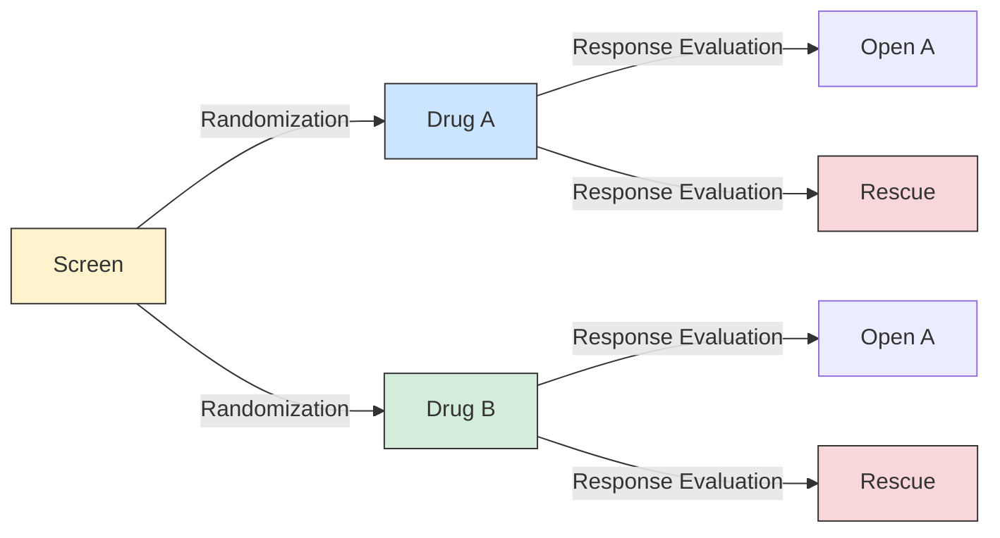

The next diagram for this trial is the prospective view. It shows the epochs of the trial and how the initial group of subjects is split into 2 treatment groups for the double-blind treatment epoch, and how each of those initial treatment groups is split in 2 at the response evaluation, resulting in the 4 arms of this trial. The names of the arms have been chosen to represent the outcomes of the successive branches that, together, assign subjects to arms. These compound names were chosen to facilitate description of subjects who may drop out of the trial after the first branch and before the second branch. Example 7 in Section 5.2, Demographics, illustrates DM and Subject Elements (SE) data for such subjects.

**Prospective View**

> KB note (not in SDTMIG): the following Mermaid diagram is a KB rendering of the PDF figure "Example Trial 3, Multiple Branches Prospective View".

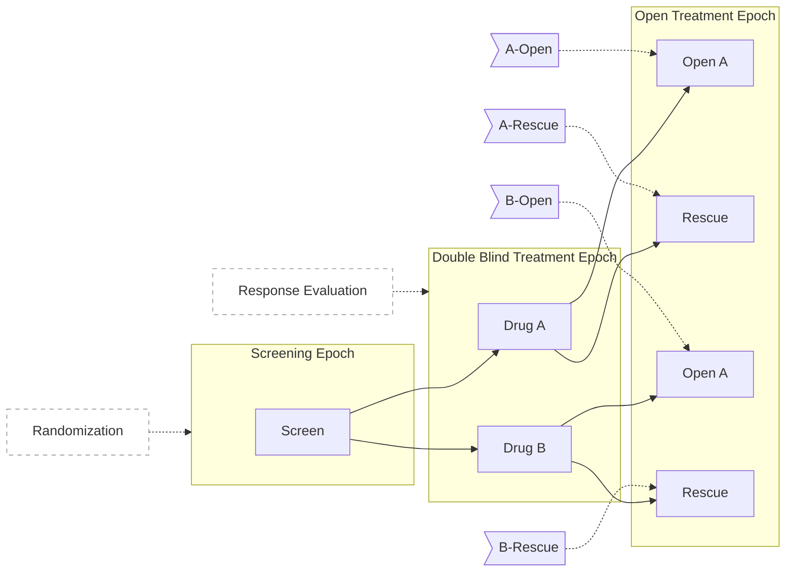

The next diagram shows the retrospective view. As with the first 2 example trials, there is 1 element in each study cell.

**Retrospective View**

> KB note (not in SDTMIG): the following Mermaid diagram is a KB rendering of the PDF figure "Example Trial 3, Multiple Branches Retrospective View".

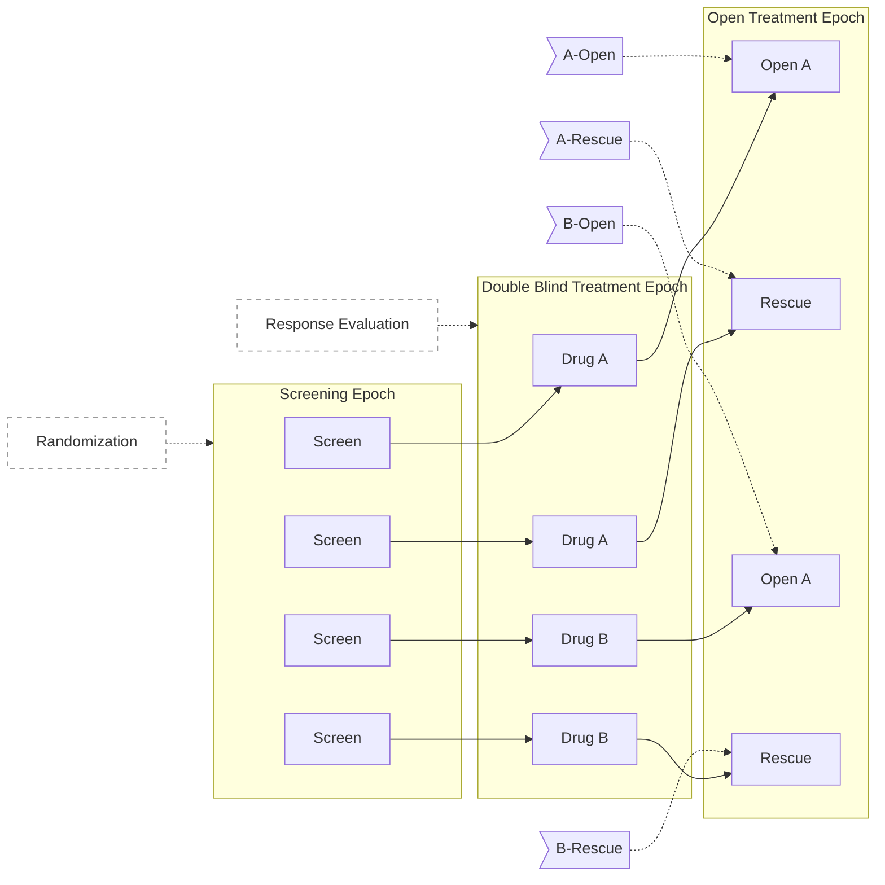

The last diagram for this trial shows the trial from the viewpoint of blinded participants. Since the prospective view is the view most relevant to study participants, the blinded view shown here is a prospective view. Because blinded participants can tell which treatment a subject receives in the Open Label epoch, they see 2 possible element sequences.

**Blinded View**

> KB note (not in SDTMIG): the following Mermaid diagram is a KB rendering of the PDF figure "Example Trial 3, Multiple Branches Blinded View".

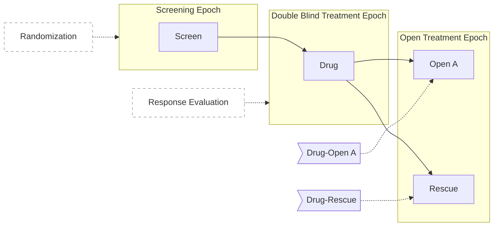

The trial design matrix for this trial can be constructed easily from the diagram showing arms and epochs.

**Trial Design Matrix**

|  | Screen | Double Blind | Open Label |
|---|---|---|---|
| **A-Open A** | Screen | Treatment A | Open Drug A |
| **A-Rescue** | Screen | Treatment A | Rescue |
| **B-Open A** | Screen | Treatment B | Open Drug A |
| **B-Rescue** | Screen | Treatment B | Rescue |

Creating the TA dataset for this example trial is similarly straightforward. Note that because there are 2 branch points in this trial, TABRANCH is populated for 2 records in each arm. Note also that the values of ARMCD, like the values of ARM, reflect the 2 separate processes that result in a subject's assignment to an arm.

**ta.xpt**

| Row | STUDYID | DOMAIN | ARMCD | ARM | TAETORD | ETCD | ELEMENT | TABRANCH | TATRANS | EPOCH |
|-----|---------|--------|-------|-----|---------|------|---------|----------|---------|-------|
| 1 | EX3 | TA | AA | A-Open A | 1 | SCRN | Screen | Randomized to Treatment A | | SCREENING |
| 2 | EX3 | TA | AA | A-Open A | 2 | DBA | Treatment A | Assigned to Open Drug A on basis of response evaluation | | BLINDED TREATMENT |
| 3 | EX3 | TA | AA | A-Open A | 3 | OA | Open Drug A | | | OPEN LABEL TREATMENT |
| 4 | EX3 | TA | AR | A-Rescue | 1 | SCRN | Screen | Randomized to Treatment A | | SCREENING |
| 5 | EX3 | TA | AR | A-Rescue | 2 | DBA | Treatment A | Assigned to Rescue on basis of response evaluation | | BLINDED TREATMENT |
| 6 | EX3 | TA | AR | A-Rescue | 3 | RSC | Rescue | | | OPEN LABEL TREATMENT |
| 7 | EX3 | TA | BA | B-Open A | 1 | SCRN | Screen | Randomized to Treatment B | | SCREENING |
| 8 | EX3 | TA | BA | B-Open A | 2 | DBB | Treatment B | Assigned to Open Drug A on basis of response evaluation | | BLINDED TREATMENT |
| 9 | EX3 | TA | BA | B-Open A | 3 | OA | Open Drug A | | | OPEN LABEL TREATMENT |
| 10 | EX3 | TA | BR | B-Rescue | 1 | SCRN | Screen | Randomized to Treatment B | | SCREENING |
| 11 | EX3 | TA | BR | B-Rescue | 2 | DBB | Treatment B | Assigned to Rescue on basis of response evaluation | | BLINDED TREATMENT |
| 12 | EX3 | TA | BR | B-Rescue | 3 | RSC | Rescue | | | OPEN LABEL TREATMENT |

See Section 7.2.1.1 Trial Arms Issues, Distinguishing Between Branches and Transitions, for additional discussion regarding when a decision point in a trial design should be considered to give rise to a new arm.

## Example 4

> KB note (not in SDTMIG): A cyclical chemotherapy oncology trial with repeating treatment/rest elements until disease progression. 2 arms (Drug A, Drug B), 3 epochs (Screening, Treatment, Follow-Up). The TATRANS variable represents the "repeat until disease progression" skip-forward rule.

The following diagram uses a new symbol, a large curved arrow representing the fact that the chemotherapy treatment (A or B) and the rest period that follows it are to be repeated. In this trial, the chemotherapy cycles are to be repeated until disease progression. Although some chemotherapy trials specify a maximum number of cycles, protocols that allow an indefinite number of repeats are not uncommon.

> KB note (not in SDTMIG): Maximum of 4 cycles assumed in this example.

**Study Schema**

> KB note (not in SDTMIG): the following Mermaid diagram is a KB rendering of the PDF figure "Example Trial 4, Cyclical Chemotherapy Study Schema".

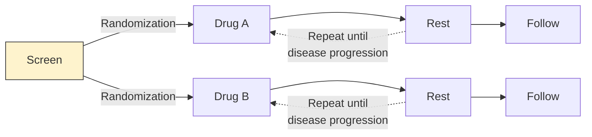

The next diagram shows the prospective view of this trial. Note that, in spite of the repeating element structure, this is, at its core, a 2-arm parallel study, and thus has 2 arms. In SDTMIG 3.1.1, there was an implicit assumption that each element must be in a separate epoch, and trials with cyclical chemotherapy were difficult to handle. The introduction of the concept of study cells and the dropping of the assumption that elements and epochs have a one-to-one relationship resolved these difficulties. This trial is best treated as having just 3 epochs, since the main objectives of the trial involve comparisons between the 2 treatments and do not require data to be considered cycle by cycle.

**Prospective View**

> KB note (not in SDTMIG): the following Mermaid diagram is a KB rendering of the PDF figure "Example Trial 4, Cyclical Chemotherapy Prospective View".

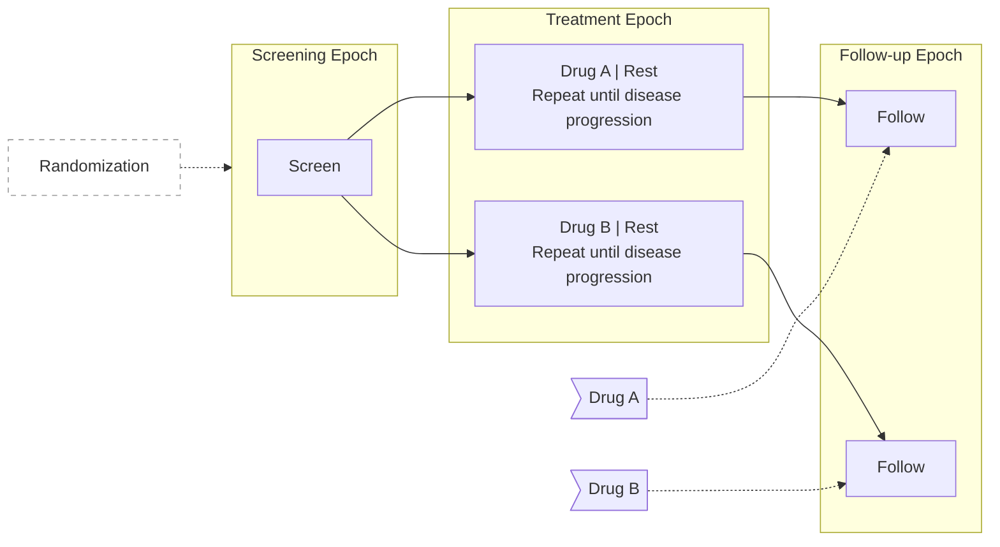

The next diagram shows the retrospective view of this trial.

**Retrospective View**

> KB note (not in SDTMIG): the following Mermaid diagram is a KB rendering of the PDF figure "Example Trial 4, Cyclical Chemotherapy Retrospective View".

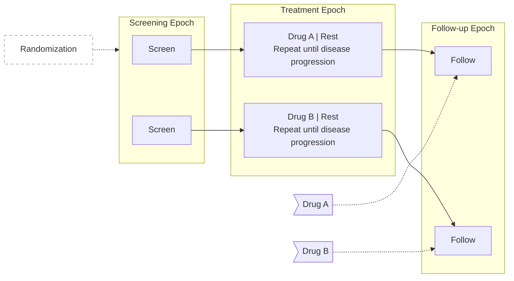

For the purpose of developing a TA dataset for this oncology trial, the diagram must be redrawn to explicitly represent multiple treatment and rest elements. If a maximum number of cycles is not given by the protocol, then—for the purposes of constructing an SDTM TA dataset for submission, which can only take place after the trial is complete—the number of repeats included in the TA dataset should be the maximum number of repeats that occurred in the trial. The next diagram assumes that the maximum number of cycles that occurred in this trial was 4. Some subjects will not have received all 4 cycles, because their disease progressed. The rule that directed that they receive no further cycles of chemotherapy is represented by a set of green arrows, 1 at the end of each rest epoch, that shows that a subject “skips forward” if their disease progresses. In the TA dataset, each skip-forward instruction is a transition rule, recorded in the TATRANS variable; when TATRANS is not populated, the rule is to transition to the next element in sequence.

**Retrospective View with Explicit Repeats**

> KB note (not in SDTMIG): the following Mermaid diagram is a KB rendering of the PDF figure "Example Trial 4, Cyclical Chemotherapy Retrospective View with Explicit Repeats".

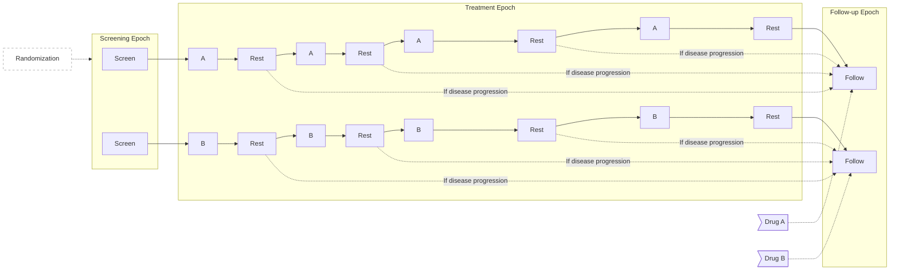

The logistics of dosing mean that few oncology trials are blinded; the next diagram, however, shows the trial from the viewpoint of blinded participants if this trial is blinded.

**Blinded View**

> KB note (not in SDTMIG): the following Mermaid diagram is a KB rendering of the PDF figure "Example Trial 4, Cyclical Chemotherapy Blinded View".

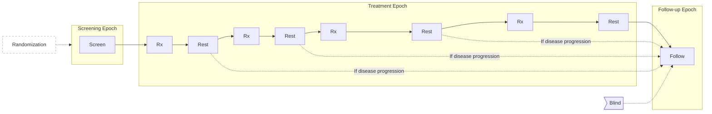

The trial design matrix for this example trial corresponds to the diagram showing the retrospective view, with explicit repeats of the treatment and rest elements. As previously noted, the trial design matrix does not include information regarding when randomization occurs; similarly, information corresponding to the skip-forward rules is not represented in the trial design matrix.

**Trial Design Matrix**

|  | Screen | Treatment | | | | | | | | Follow-up |
|---|---|---|---|---|---|---|---|---|---|---|
| **A** | Screen | Trt A | Rest | Trt A | Rest | Trt A | Rest | Trt A | Rest | Follow-up |
| **B** | Screen | Trt B | Rest | Trt B | Rest | Trt B | Rest | Trt B | Rest | Follow-up |

The TA dataset for this example trial requires the use of the TATRANS variable to represent the "repeat until disease progression" feature (the green "skip forward" arrow represented this rule in the diagrams). In the TA dataset, TATRANS is populated for each element with a green arrow in the diagram. In other words, if there is a possibility that a subject will, at the end of this element, skip forward to a later part of the arm, then TATRANS is populated with the rule describing the conditions under which a subject will go to a later element. If the subject always goes to the next element in the arm (see Example Trials 1-3), then TATRANS is null. The TA dataset presented below corresponds to the trial design matrix.

**ta.xpt**

| Row | STUDYID | DOMAIN | ARMCD | ARM | TAETORD | ETCD | ELEMENT | TABRANCH | TATRANS | EPOCH |
|-----|---------|--------|-------|-----|---------|------|---------|----------|---------|-------|
| 1 | EX4 | TA | A | A | 1 | SCRN | Screen | Randomized to A | | SCREENING |
| 2 | EX4 | TA | A | A | 2 | A | Trt A | | | TREATMENT |
| 3 | EX4 | TA | A | A | 3 | REST | Rest | | If disease progression, go to Follow-up Epoch | TREATMENT |
| 4 | EX4 | TA | A | A | 4 | A | Trt A | | | TREATMENT |
| 5 | EX4 | TA | A | A | 5 | REST | Rest | | If disease progression, go to Follow-up Epoch | TREATMENT |
| 6 | EX4 | TA | A | A | 6 | A | Trt A | | | TREATMENT |
| 7 | EX4 | TA | A | A | 7 | REST | Rest | | If disease progression, go to Follow-up Epoch | TREATMENT |
| 8 | EX4 | TA | A | A | 8 | A | Trt A | | | TREATMENT |
| 9 | EX4 | TA | A | A | 9 | REST | Rest | | | TREATMENT |
| 10 | EX4 | TA | A | A | 10 | FU | Follow-up | | | FOLLOW-UP |
| 11 | EX4 | TA | B | B | 1 | SCRN | Screen | Randomized to B | | SCREENING |
| 12 | EX4 | TA | B | B | 2 | B | Trt B | | | TREATMENT |
| 13 | EX4 | TA | B | B | 3 | REST | Rest | | If disease progression, go to Follow-up Epoch | TREATMENT |
| 14 | EX4 | TA | B | B | 4 | B | Trt B | | | TREATMENT |
| 15 | EX4 | TA | B | B | 5 | REST | Rest | | If disease progression, go to Follow-up Epoch | TREATMENT |
| 16 | EX4 | TA | B | B | 6 | B | Trt B | | | TREATMENT |
| 17 | EX4 | TA | B | B | 7 | REST | Rest | | If disease progression, go to Follow-up Epoch | TREATMENT |
| 18 | EX4 | TA | B | B | 8 | B | Trt B | | | TREATMENT |
| 19 | EX4 | TA | B | B | 9 | REST | Rest | | | TREATMENT |
| 20 | EX4 | TA | B | B | 10 | FU | Follow-up | | | FOLLOW-UP |

## Example 5

Example Trial 5 is much like Example Trial 4, in that the 2 treatments being compared are given in cycles, and the total length of the cycle is the same for both treatments. In this trial, however, treatment A is given over longer duration than treatment B. Because of this difference in treatment patterns, this trial cannot be blinded.

**Study Schema**

> KB note (not in SDTMIG): the following Mermaid diagram is a KB rendering of the PDF figure "Example Trial 5, Different Chemo Durations Study Schema".

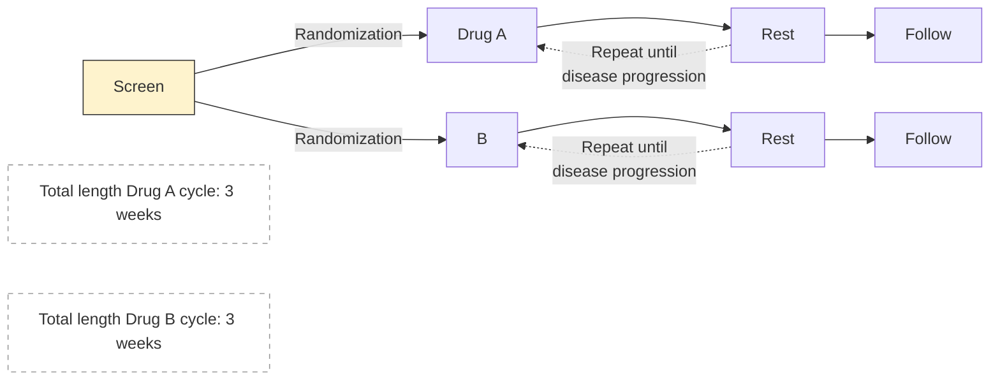

The assumption of a one-to-one relationship between elements and epochs makes such situations difficult to handle. However, without that assumption, this trial is essentially the same as Trial 4. The next diagram shows the retrospective view of this trial.

**Retrospective View**

> KB note (not in SDTMIG): the following Mermaid diagram is a KB rendering of the PDF figure "Example Trial 5, Cyclical Chemotherapy Retrospective View".

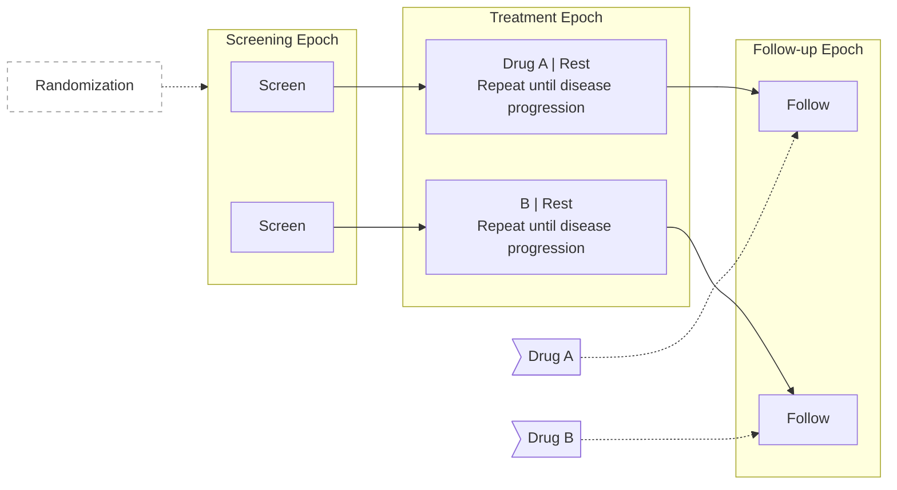

The trial design matrix for this trial is almost the same as for Example Trial 4; the only difference is that the maximum number of cycles for this trial was assumed to be 3.

**Trial Design Matrix**

|  | Screen | Treatment | | | | | | Follow-up |
|---|---|---|---|---|---|---|---|---|
| **A** | Screen | Trt A | Rest A | Trt A | Rest A | Trt A | Rest A | Follow-up |
| **B** | Screen | Trt B | Rest B | Trt B | Rest B | Trt B | Rest B | Follow-up |

The TA dataset for this trial shown below corresponds to the trial design matrix.

**ta.xpt**

| Row | STUDYID | DOMAIN | ARMCD | ARM | TAETORD | ETCD | ELEMENT | TABRANCH | TATRANS | EPOCH |
|-----|---------|--------|-------|-----|---------|------|---------|----------|---------|-------|
| 1 | EX5 | TA | A | A | 1 | SCRN | Screen | Randomized to A | | SCREENING |
| 2 | EX5 | TA | A | A | 2 | A | Trt A | | | TREATMENT |
| 3 | EX5 | TA | A | A | 3 | RESTA | Rest A | | If disease progression, go to Follow-up Epoch | TREATMENT |
| 4 | EX5 | TA | A | A | 4 | A | Trt A | | | TREATMENT |
| 5 | EX5 | TA | A | A | 5 | RESTA | Rest A | | If disease progression, go to Follow-up Epoch | TREATMENT |
| 6 | EX5 | TA | A | A | 6 | A | Trt A | | | TREATMENT |
| 7 | EX5 | TA | A | A | 7 | RESTA | Rest A | | | TREATMENT |
| 8 | EX5 | TA | A | A | 8 | FU | Follow-up | | | FOLLOW-UP |
| 9 | EX5 | TA | B | B | 1 | SCRN | Screen | Randomized to B | | SCREENING |
| 10 | EX5 | TA | B | B | 2 | B | Trt B | | | TREATMENT |
| 11 | EX5 | TA | B | B | 3 | RESTB | Rest B | | If disease progression, go to Follow-up Epoch | TREATMENT |
| 12 | EX5 | TA | B | B | 4 | B | Trt B | | | TREATMENT |
| 13 | EX5 | TA | B | B | 5 | RESTB | Rest B | | If disease progression, go to Follow-up Epoch | TREATMENT |
| 14 | EX5 | TA | B | B | 6 | B | Trt B | | | TREATMENT |
| 15 | EX5 | TA | B | B | 7 | RESTB | Rest B | | | TREATMENT |
| 16 | EX5 | TA | B | B | 8 | FU | Follow-up | | | FOLLOW-UP |

## Example 6

Example Trial 6 is an oncology trial comparing 2 types of chemotherapy that are given using cycles of different lengths with different internal patterns. Treatment A is given in 3-week cycles with a longer duration of treatment and a short rest; treatment B is given in 4-week cycles with a short duration of treatment and a long rest.

**Study Schema**

> KB note (not in SDTMIG): the following Mermaid diagram is a KB rendering of the PDF figure "Example Trial 6, Different Cycle Durations Study Schema".


The design of this trial is very similar to that for Example Trials 4 and 5. The main difference is that there are 2 different rest elements: the short one used with drug A and the long one used with drug B. The next diagram shows the retrospective view of this trial.

**Retrospective View**

> KB note (not in SDTMIG): the following Mermaid diagram is a KB rendering of the PDF figure "Example Trial 6, Cyclical Chemotherapy Retrospective View".

```mermaid
graph LR
    subgraph SE["Screening Epoch"]
        s1[Screen]
        s2[Screen]
    end
    subgraph TE["Treatment Epoch"]
        da["Drug A | Rest<br/>Repeat until disease progression<br/>Total length Drug A cycle: 3 weeks"]
        db["B | Rest<br/>Repeat until disease progression<br/>Total length Drug B cycle: 4 weeks"]
    end
    subgraph FU["Follow-up Epoch"]
        f1[Follow]
        f2[Follow]
    end
    s1 --> da --> f1
    s2 --> db --> f2
    armA>"Drug A"] -.-> f1
    armB>"Drug B"] -.-> f2
    rand["Randomization"] -.-> SE
    style rand fill:#fff,stroke:#999,stroke-dasharray:5 5
```

The trial design matrix for this trial assumes that there was a maximum of 4 cycles of drug A and a maximum of three cycles of drug B.

**Trial Design Matrix**

|  | Screen | Treatment | | | | | | | | Follow-up |
|---|---|---|---|---|---|---|---|---|---|---|
| **A** | Screen | Trt A | Rest A | Trt A | Rest A | Trt A | Rest A | Trt A | Rest A | Follow-up |
| **B** | Screen | Trt B | Rest B | Trt B | Rest B | Trt B | Rest B | | | Follow-up |

In the following TA dataset, because the treatment epoch for arm A has more elements than the treatment epoch for arm B, TAETORD is 10 for the follow-up element in arm A, but 8 for the follow-up element in arm B. (It would also be possible to assign a TAETORD value of 10 to the follow-up element in arm B.) The primary purpose of TAETORD is to order elements within an arm; leaving gaps in the series of TAETORD values does not interfere with this purpose.

**ta.xpt**

| Row | STUDYID | DOMAIN | ARMCD | ARM | TAETORD | ETCD | ELEMENT | TABRANCH | TATRANS | EPOCH |
|-----|---------|--------|-------|-----|---------|------|---------|----------|---------|-------|
| 1 | EX6 | TA | A | A | 1 | SCRN | Screen | Randomized to A | | SCREENING |
| 2 | EX6 | TA | A | A | 2 | A | Trt A | | | TREATMENT |
| 3 | EX6 | TA | A | A | 3 | RESTA | Rest A | | If disease progression, go to Follow-up Epoch | TREATMENT |
| 4 | EX6 | TA | A | A | 4 | A | Trt A | | | TREATMENT |
| 5 | EX6 | TA | A | A | 5 | RESTA | Rest A | | If disease progression, go to Follow-up Epoch | TREATMENT |
| 6 | EX6 | TA | A | A | 6 | A | Trt A | | | TREATMENT |
| 7 | EX6 | TA | A | A | 7 | RESTA | Rest A | | If disease progression, go to Follow-up Epoch | TREATMENT |
| 8 | EX6 | TA | A | A | 8 | A | Trt A | | | TREATMENT |
| 9 | EX6 | TA | A | A | 9 | RESTA | Rest A | | | TREATMENT |
| 10 | EX6 | TA | A | A | 10 | FU | Follow-up | | | FOLLOW-UP |
| 11 | EX6 | TA | B | B | 1 | SCRN | Screen | Randomized to B | | SCREENING |
| 12 | EX6 | TA | B | B | 2 | B | Trt B | | | TREATMENT |
| 13 | EX6 | TA | B | B | 3 | RESTB | Rest B | | If disease progression, go to Follow-up Epoch | TREATMENT |
| 14 | EX6 | TA | B | B | 4 | B | Trt B | | | TREATMENT |
| 15 | EX6 | TA | B | B | 5 | RESTB | Rest B | | If disease progression, go to Follow-up Epoch | TREATMENT |
| 16 | EX6 | TA | B | B | 6 | B | Trt B | | | TREATMENT |
| 17 | EX6 | TA | B | B | 7 | RESTB | Rest B | | | TREATMENT |
| 18 | EX6 | TA | B | B | 8 | FU | Follow-up | | | FOLLOW-UP |

## Example 7

In open trials, there is no requirement to maintain a blind, and the arms of a trial may be quite different from each other. In such a case, changes in treatment in one arm may differ in number and timing from changes in treatment in another, so that there is nothing like a one-to-one match between the elements in the different arms. In such a case, epochs are likely to be defined as broad intervals of time, spanning several elements, and chosen to correspond to periods of time that will be compared in analyses of the trial.

Example Trial 7, RTOG 93-09, involves treatment of lung cancer with chemotherapy and radiotherapy, with or without surgery. The protocol (RTOG-93-09), which was provided by the Radiation Oncology Therapy Group (RTOG), does not include a study schema diagram, but does include a text-based representation of diverging “options” to which a subject may be assigned. All subjects go through the branch point at randomization, when they are assigned to either chemotherapy plus radiotherapy (CR) or chemotherapy and radiotherapy plus surgery (CRS). All subjects receive induction chemotherapy and radiation, with a slight difference between those randomized to the 2 arms during the second cycle of chemotherapy. Those randomized to the non-surgery arm are evaluated for disease somewhat earlier, to avoid delays in administering the radiation boost to those whose disease has not progressed. After induction chemotherapy and radiation, subjects are evaluated for disease progression, and those whose disease has progressed stop treatment, but enter follow-up. Not all subjects randomized to receive surgery who do not have disease progression will necessarily receive surgery. If they are poor candidates for surgery or do not wish to receive surgery, they will not receive surgery, but will receive further chemotherapy. The following diagram is based on the text “schema” in the protocol, with the 5 options it names. The diagram in this form might suggest that the trial has 5 arms.

**Study Schema with 5 "options"**

> KB note (not in SDTMIG): the following Mermaid diagram is a KB rendering of the PDF figure "Example Trial 7, RTOG 93-09 Study Schema with 5 "options"".

```mermaid
graph LR
    S[Screen]
    S -->|"Randomization"| A1["Chemo<br/>+ Rad"] --> A2["Chemo<br/>+ Rad*"]
    S -->|"Randomization"| B1["Chemo<br/>+ Rad"] --> B2["Chemo<br/>+ Rad**"]
    A2 -->|"Evaluation for Disease Progression"| F2["Follow (option 2)"]
    A2 -->|"Evaluation for Disease Progression"| CB["Chemo<br/>+ Boost"] --> C5[Chemo] --> F5["Follow (option 5)"]
    B2 -->|"Evaluation for Disease Progression and Surgical Eligibility"| R3["3-5 w<br/>Rest"] --> SG[Surgery] --> R4["4-6 w<br/>Rest"] --> C3a[Chemo] --> C3b[Chemo] --> F3["Follow (option 3)"]
    B2 -->|"Evaluation for Disease Progression and Surgical Eligibility"| C4a[Chemo] --> C4b[Chemo] --> F4["Follow (option 4)"]
    B2 -->|"Evaluation for Disease Progression and Surgical Eligibility"| F1["Follow (option 1)"]
```

> \*Disease evaluation earlier \*\*Disease evaluation later

However, the objectives of the trial make it clear that this trial is designed to compare 2 treatment strategies, chemotherapy and radiation with and without surgery, so this study is better modeled as a 2-arm trial, but with major "skip forward" arrows for some subjects, as illustrated in the following diagram. This diagram also shows more detail within the Induction Chemo + RT and Additional Chemo blocks than the preceding diagram. Both the induction and additional chemotherapy are given in 2 cycles. The second induction cycle is different for the 2 arms, since radiation therapy for those assigned to the non-surgery arm includes a “boost” which those assigned to the surgery arm do not receive.

The next diagram shows the prospective view of this trial. The protocol conceives of treatment as being divided into 2 parts, induction and continuation, so these have been treated as 2 different epochs. This is also an important point in the trial operationally, the point when subjects are “registered” a second time, and when subjects who will skip forward are identified (i.e., because of disease progression or ineligibility for surgery).

**Prospective View**

> KB note (not in SDTMIG): the following Mermaid diagram is a KB rendering of the PDF figure "Example Trial 7, RTOG-93-09 Prospective View".

```mermaid
graph LR
    subgraph SE["Screen Epoch"]
        s1[Screen]
    end
    subgraph IE["Induction Treatment Epoch"]
        cr1["Chemo + Rad"] --> cr2["Chemo + Rad*"]
        cs1["Chemo + Rad"] --> cs2["Chemo + Rad**"]
    end
    subgraph CE["Continuation Treatment Epoch"]
        cb["Chemo + Boost"] --> cc1[Chemo]
        r3["3-5 w Rest"] --> sg[Surgery] --> r4["4-6 w Rest"] --> cc3[Chemo] --> cc4[Chemo]
    end
    subgraph FE["Follow Epoch"]
        f1[FU]
        f2[FU]
    end
    s1 --> cr1
    cr2 --> cb
    cc1 --> f1
    s1 --> cs1
    cs2 --> r3
    cc4 --> f2
    cr2 -.->|"If disease progression"| f1
    cs2 -.->|"If disease progression"| f2
    cs2 -.->|"If not eligible for surgery"| cc3
    armCR>"CR<br/>Chemotherapy and Radiation Arm"] -.-> f1
    armCRS>"CRS<br/>Chemotherapy, Radiation and Surgery Arm"] -.-> f2
    rand["Randomization"] -.-> SE
    style rand fill:#fff,stroke:#999,stroke-dasharray:5 5
```

> \*Disease evaluation earlier \*\*Disease evaluation later

The next diagram shows the retrospective view of this trial. The fact that the elements in the study cell for the CR arm in the continuation treatment epoch do not fill the space in the diagram is an artifact of the diagram conventions. Those subjects who do receive surgery will in fact spend a longer time completing treatment and moving into follow-up. Although it is tempting to think of the horizontal axis of these diagrams as a timeline, this can sometimes be misleading. The diagrams are not necessarily to scale in the sense that the length of the block representing an element represents its duration, and elements that line up on the same vertical line in the diagram may not occur at the same relative time within the study.

**Retrospective View**

> KB note (not in SDTMIG): the following Mermaid diagram is a KB rendering of the PDF figure "Example Trial 7, RTOG 93-09 Retrospective View".

```mermaid
graph LR
    subgraph SE["Screen Epoch"]
        s1[Screen]
        s2[Screen]
    end
    subgraph IE["Induction Treatment Epoch"]
        cr1["Chemo + Rad"] --> cr2["Chemo + Rad*"]
        cs1["Chemo + Rad"] --> cs2["Chemo + Rad**"]
    end
    subgraph CE["Continuation Treatment Epoch"]
        cb["Chemo + Boost"] --> cc1[Chemo]
        r3["3-5 w Rest"] --> sg[Surgery] --> r4["4-6 w Rest"] --> cc3[Chemo] --> cc4[Chemo]
    end
    subgraph FE["Follow Epoch"]
        f1[FU]
        f2[FU]
    end
    s1 --> cr1
    cr2 --> cb
    cc1 --> f1
    s2 --> cs1
    cs2 --> r3
    cc4 --> f2
    cr2 -.->|"If disease progression"| f1
    cs2 -.->|"If disease progression"| f2
    cs2 -.->|"If not eligible for surgery"| cc3
    armCR>"CR<br/>Chemotherapy and Radiation Arm"] -.-> f1
    armCRS>"CRS<br/>Chemotherapy, Radiation and Surgery Arm"] -.-> f2
    rand["Randomization"] -.-> SE
    style rand fill:#fff,stroke:#999,stroke-dasharray:5 5
```

> \*Disease evaluation earlier \*\*Disease evaluation later

The following table shows the trial design matrix for this 2-arm example trial.

**Trial Design Matrix**

|  | Screen | Induction | | Continuation | | | | | Follow-up |
|---|---|---|---|---|---|---|---|---|---|
| **CR** | Screen | Initial Chemo + RT | Chemo + RT (non-Surgery) | Chemo | Chemo | | | | Off Treatment Follow-up |
| **CRS** | Screen | Initial Chemo + RT | Chemo + RT (Surgery) | 3-5 w Rest | Surgery | 4-6 w Rest | Chemo | Chemo | Off Treatment Follow-up |

The TA dataset reflects that this is a 2-arm trial.

**ta.xpt**

| Row | STUDYID | DOMAIN | ARMCD | ARM | TAETORD | ETCD | ELEMENT | TABRANCH | TATRANS | EPOCH |
|-----|---------|--------|-------|-----|---------|------|---------|----------|---------|-------|
| 1 | EX7 | TA | 1 | CR | 1 | SCRN | Screen | Randomized to CR | | SCREENING |
| 2 | EX7 | TA | 1 | CR | 2 | ICR | Initial Chemo + RT | | | INDUCTION TREATMENT |
| 3 | EX7 | TA | 1 | CR | 3 | CRNS | Chemo+RT (non-Surgery) | | If progression, skip to Follow-up. | INDUCTION TREATMENT |
| 4 | EX7 | TA | 1 | CR | 4 | C | Chemo | | | CONTINUATION TREATMENT |
| 5 | EX7 | TA | 1 | CR | 5 | C | Chemo | | | CONTINUATION TREATMENT |
| 6 | EX7 | TA | 1 | CR | 6 | FU | Off Treatment Follow-up | | | FOLLOW-UP |
| 7 | EX7 | TA | 2 | CRS | 1 | SCRN | Screen | Randomized to CRS | | SCREENING |
| 8 | EX7 | TA | 2 | CRS | 2 | ICR | Initial Chemo + RT | | | INDUCTION TREATMENT |
| 9 | EX7 | TA | 2 | CRS | 3 | CRS | Chemo+RT (Surgery) | | If progression, skip to Follow-up. If no progression, but subject is ineligible for or does not consent to surgery, skip to Chemo. | INDUCTION TREATMENT |
| 10 | EX7 | TA | 2 | CRS | 4 | R3 | 3-5 week rest | | | CONTINUATION TREATMENT |
| 11 | EX7 | TA | 2 | CRS | 5 | SURG | Surgery | | | CONTINUATION TREATMENT |
| 12 | EX7 | TA | 2 | CRS | 6 | R4 | 4-6 week rest | | | CONTINUATION TREATMENT |
| 13 | EX7 | TA | 2 | CRS | 7 | C | Chemo | | | CONTINUATION TREATMENT |
| 14 | EX7 | TA | 2 | CRS | 8 | C | Chemo | | | CONTINUATION TREATMENT |
| 15 | EX7 | TA | 2 | CRS | 9 | FU | Off Treatment Follow-up | | | FOLLOW-UP |

## Trial Arms Issues

### Distinguishing Between Branches and Transitions

Both the Branch and Transition columns contain rules, but the 2 columns represent 2 different types of rules. **Branch rules** represent forks in the trial flowchart, giving rise to separate arms. The rule underlying a branch in the trial design appears in multiple records, once for each "fork" of the branch. Within any one record, there is no choice (no "if" clause) in the value of the branch condition. For example, the value of TABRANCH for a record in arm A is "Randomized to Arm A" because a subject in arm A must have been randomized to arm A. **Transition rules** are used for choices within an arm. The value for TATRANS does contain a choice (an "if" clause). In Example Trial 4, subjects who receive 1, 2, 3, or 4 cycles of treatment A are all considered to belong to arm A.

In modeling a trial, decisions may have to be made about whether a decision point in the flow chart represents the separation of paths that represent different arms, or paths that represent variations within the same arm, as illustrated in the discussion of Example Trial 7. This decision will depend on the comparisons of interest in the trial.

Some trials refer to groups of subjects who follow a particular path through the trial as "cohorts," particularly if the groups are formed successively over time. The term "cohort" is used with different meanings in different protocols and does not always correspond to an arm.

### Subjects Not Assigned to an Arm

Some trial subjects may drop out of the study before they reach all of the branch points in the trial design. In the Demographics (DM) domain, the values of ARM and ARMCD must be supplied for such subjects, but the special values used for these subjects should not be included in the Trial Arms (TA) dataset; only complete arm paths should be described in the TA dataset. In Section 5.2, Demographics, assumption 4 describes special ARM and ARMCD values used for subjects who do not reach the first branch point in a trial. When a trial design includes 2 or more branches, special values of ARM and ARMCD may be needed for subjects who pass through the first branch point, but drop out before the final branch point. See DM Example 3 for how to represent ARM and ARMCD values for such trials.

### Defining Epochs

The series of examples for the TA dataset provides a variety of scenarios and guidance about how to assign epoch in those scenarios. In general, assigning epochs for blinded trials is easier than for unblinded trials. The blinded view of the trial will generally make the possible choices clear. For unblinded trials, the comparisons that will be made between arms can guide the definition of epochs. For trials that include many variant paths within an arm, comparisons of arms will mean that subjects on a variety of paths will be included in the comparison, and this is likely to lead to definition of broader epochs.

### Rule Variables

The Branch and Transition columns shown in the example tables are variables with a Role of “Rule.” The values of a Rule variable describe conditions under which something is planned to happen. At the moment, values of Rule variables are text. At some point in the future, it is expected that a mechanism to provide machine-readable rules will become available. Other Rule variables are present in the Trial Elements (TE) and Trial Visits (TV) datasets.
