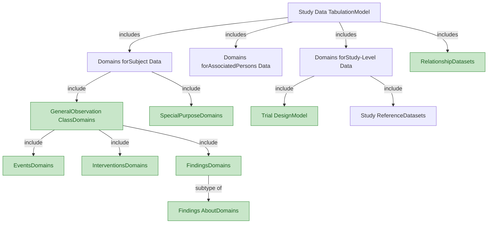

# SDTM v2.0 — Sections 1-2: Introduction; Model Concepts and Terms – Organization of the SDTM

Source: SDTM v2.0, Sections 1-2 (Pages 4-10)

## 1 Introduction

## 1.1 Purpose

This document describes the Study Data Tabulation Model (SDTM), which defines a standard structure for study data tabulations. This document, which supersedes all prior versions, includes numerous changes from the prior version (SDTM v1.8). These changes are described in Section 1.4, Significant Changes from Prior Versions, and Section 7, Changes from SDTM v1.8 to SDTM v2.0.

This document is intended for companies and individuals involved in the collection, preparation, and analysis of study data that may be used for various purposes, including publication, warehousing, meta-analyses, and regulatory submission. Guidance and specifications for the application of this model are provided separately in the implementation guides (IGs). Regulatory authorities provide separate guidance, specification, and regulations. Readers are advised to refer to these documents before preparing a regulatory submission based on the SDTM.

## 1.2 Implementation Advice for this Model

The SDTM has been designed to accommodate the broadest range of human and animal study data in a standardized manner. This document describes the basic concepts and general structure of the model. Individual implementation guides (IGs) have been created to provide specific recommendations for numerous domains of data commonly collected in human, animal, and medical device studies, identifying which variables from a general observation class may apply. These IGs also describe basic assumptions and business rules, and provide numerous examples for mapping data to the standard format. Sponsors wishing to represent data in the standard formats should consult the IGs before preparing datasets based on the SDTM. The following implementation guides have been published by CDISC:

- The Study Data Tabulation Model Implementation Guide for Human Clinical Trials (SDTMIG) https://www.cdisc.org/standards/foundational/sdtmig
- The Study Data Tabulation Model Implementation Guide for Medical Devices (SDTMIG-MD) https://www.cdisc.org/standards/foundational/sdtm-ig-md
- The Study Data Tabulation Model Implementation Guide: Associated Persons (SDTMIG-AP) https://www.cdisc.org/standards/foundational/sdtmig/sdtmig-ap
- The Standard for Exchange of Nonclinical Data Implementation Guide (SENDIG) https://www.cdisc.org/standards/foundational/send
- The Standard for Exchange of Nonclinical Data Implementation Guide: Developmental and Reproductive Toxicology (SENDIG-DART) https://www.cdisc.org/standards/foundational/send/sendig-dart
- The Standard for Exchange of Nonclinical Data Implementation Guide: Animal Rule (SENDIG-AR) https://www.cdisc.org/standards/foundational/send/sendig-animal-rule

In addition to the IGs, CDISC implementation advice is contained in:

- Multiple indication-specific therapeutic area user guides (TAUGs; https://www.cdisc.org/standards/therapeutic-areas), which provide examples and implementation advice for various therapeutic areas.
- Supplements for individual questionnaires, ratings, and scales (QRS; https://www.cdisc.org/foundational/qrs), which provide information on how to structure the data in a standard format for public domain and copyright-approved instruments.
- The CDISC Controlled Terminology website page (https://www.cdisc.org/standards/terminology/controlled-terminology).

## 1.3 Relationship to Prior CDISC Models

This document is a major release of the SDTM. The content of the model has been rearranged and revised to update explanatory text. Tables have been revised to separate material previously included in the Description column into separate metadata, as described in the next section.

The SDTM has evolved to support a broad range of study types and regulated products, and is expected to evolve further to support an even broader range of study data.

## 1.4 Significant Changes from Prior Versions

The SDTM has been designed for backward compatibility; datasets prepared with prior versions should be compatible with v2.0. In most cases, this means that later versions may add new variables or correct textual errors, but do not eliminate variables or structures incorporated in prior versions. There are, however, isolated instances where some older variables may be deprecated in favor of newer, more functional variables.

### Reorganization of Content

The content has been reorganized; the content of some sections has been relocated, some section names have changed, and some sections have been added, most notably:

- Content from Model Fundamentals has been moved to Section 2, Model Concepts and Terms – Organization of the SDTM, and Section 3, Study Subject Data.
- Content from Applying Model Fundamentals to Associated Persons is now in Section 4, Associated Persons Data and Section 6.6, Associated Persons Relationships.
- The table contained in Variables Used in Associated Persons Data is now in Section 4, Associated Persons Data.
- Content from Domain-specific Variables for General Observation Classes was moved to Section 3.1.1, The Interventions Observation Class, Section 3.1.2, The Events Observation Class, and Section 3.1.3, The Findings Observation Class.
- Content from SDTM Version History is now in Section 7, Changes from SDTM v1.8 to SDTM v2.0.
- The headings Representing Relationships among Datasets; Records and Datasets for Study References; and Variable, Dataset, and Section Changes and Additions were determined to be unnecessary extra section levels and were deleted.

In this version of the SDTM, tables are not numbered. No section contained more than 1 table, so table numbers added no information to section numbers.

### Changes to Structures of Tables

All tables have been updated to include the following columns:

- Variable Name
- Variable Label
- Type
- Format
- Role
- Variable Qualified (when Role is "Variable Qualifier" or "Synonym Qualifier")
- Usage Restrictions
- Variable C-code
- Definition
- Notes
- Examples

Information previously in the Description column has been moved into or replaced by text in new columns.

- Text indicating that variables are not to be used for human clinical trials now appears in the Usage Restrictions column.
- Examples formerly in the Description column were moved into the Examples column. Example values are enclosed in quotation marks.
- Other content in the Description column is now in the Notes column, except that for variables with definitions, definition-like text has been removed.
- Not all variables currently have approved definitions. Missing variable definitions will be added in future versions of the SDTM as they are developed and approved.
- Not all variables currently have approved c-codes. Missing c-codes will be added in future versions of the SDTM as they are developed and approved.

Variables that were previously represented in a separate table of Domain-Specific Variables for General Observation Classes have been moved to tables of variables for the appropriate general observation class, with a note in the Usage Restrictions column giving the domain(s) to which use is restricted. The role of the domain-specific variable --BEATNO was changed to Identifier, so it was included in Section 3.1.4, Identifiers for All Classes, rather than Section 3.1.3, The Findings Observation Class.

Usage Restrictions previously mentioned only in the SDTMIG and/or the Standard for Exchange of Nonclinical Data Implementation Guide (SENDIG) were added:

- --OCCUR may not be used in the AE domain.
- --STDTC, --STDY, --XSTDY, and --CHSTDY may not be used in Findings domains.

For each general observation class, 1 table of variables was created by combining former tables for the topic variable and the qualifier variables.

### Changes to Datasets and Variables

The Subject Visits domain, which was a special-purpose domain, has been moved to an Events class domain. The variable "SVUPDES" became a domain-specific Events class variable.

A new relationships domain, Related Specimens (RELSPEC), has been added. This domain, first introduced in the provisional SDTMIG-PGx (now deprecated), had not previously been a part of the SDTM. RELSPEC was added to this version of the SDTM because the domain was added to SDTMIG v3.4.

SDTM v2.0 does not identify any proposed deprecated variables, as there are no variables to be deprecated at this time.

The variable APID was removed from Section 3.1.4, Identifiers for All Classes, because APID is only allowed in AP domains. It is still listed in Section 4, Associated Persons Data.

New variables have been added to the following sections:

- Section 3.1.1, The Interventions Observation Class
- Section 3.1.2, The Events Observation Class
- Section 3.1.3, The Findings Observation Class
- Section 3.1.5, Timing Variables for All Classes
- Section 3.2.3.1, Subject Elements

The role of the --LOINC variable in Section 3.1.3, The Findings Observation Class, was changed from Synonym Qualifier of --TESTCD to Record Qualifier, because a single value of --TESTCD may be associated with multiple values of --LOINC, depending on the values of other variables, such as --SPEC and --METHOD.

The order of --METHOD within Interventions Variables in Section 3.1.1, The Interventions Observation Class, was changed so that the variable appears after --PORTOT, rather than after --LOC. This change was made so that --METHOD would appear after the variable qualifiers of --LOC rather than immediately after --LOC.

A number of changes are proposed for the next version of the SDTM. See Section 8, Proposed Future Changes to the SDTM, for the rationale for these proposed changes.

## 2 Model Concepts and Terms – Organization of the SDTM

The SDTM provides a general framework for describing the organization of information collected during human and animal studies. The model is built around the concept of **observations**, which consist of discrete pieces of information collected during a study. Observations normally correspond to rows in a dataset. A **domain** is a collection of observations on a particular topic (see Concept Map, below). For example, "Subject 101 had an adverse event of mild nausea starting on study day 6" is an observation belonging to the Adverse Events domain in a clinical trial.

The primary purpose of the SDTM is to represent data about study subjects—which may be humans or animals—or medical devices. The SDTM includes a general model for representing data in 3 "general observation" classes. Within those classes, data are grouped by topic into domains, represented in separate datasets. The 3 general observation classes (i.e., Interventions, Events, Findings) are described further in Section 3.1, The General Observation Classes. Additional special-purpose datasets about individuals are described in Section 3.2, Special-purpose Domains.

Studies sometimes include data about "associated persons" who are not study subjects; these data are represented in domains based on the domains used to represent data about study subjects. The structure of these domains is described in Section 4, Associated Persons Data.

The SDTM also includes a set of tables for representing data at the study level. These datasets are specified in Section 5, Study-level Data.

The last group of datasets in the SDTM are those that describe relationships among datasets and records. These datasets are specified in Section 6, Datasets for Representing Relationships.

### Concept Map. Relationships Between SDTM Domains

> **Key:** Plain box = Group of individually specified datasets. Green filled box = Extensible set of domains based on a common model.

## 2.1 Model Concepts and Terms – Variables

### Variable Roles

All datasets are structured as flat files with rows representing observations and columns representing variables; each dataset is described by metadata definitions that provide information about the variables used in the dataset. Metadata are described in the CDISC Define-XML specification, available at https://www.cdisc.org/standards/data-exchange/define-xml.

Each observation consists of a series of named variables. Each variable, which normally corresponds to a column in a dataset, can be classified according to its **role**. A role describes the type of information conveyed by the variable about each distinct observation and how it can be used. There are variables which play different roles in different datasets. This is most common for variables which appear in both trial design datasets and general observation class datasets. For example, ARMCD is the topic variable in Trial Arms (TA), but a record qualifier in Demographics (DM) and Trial Visits (TV). Variables which appear in multiple general observation classes have the same role, although the variable qualified by a variable qualifier or synonym qualifier can be different in different general observation classes. For example, --MODIFY qualifies --TRT in interventions, --TERM in events, and --ORRES in findings.

SDTM variables can be classified into 5 major roles:

- **Identifier variables**, such as those that identify the study, the subject involved in the study, the domain, and the sequence number of the record;
- **Topic variables**, which specify the focus of the observation (e.g., the name of a lab test);
- **Timing variables**, which describe the timing of an observation (e.g., start date, end date);
- **Qualifier variables**, which include additional illustrative text or numeric values that describe the results or additional traits of the observation (e.g., units, descriptive adjectives); and
- **Rule variables**, which describe the conditions for starting, ending, branching, or looping in the Trial Design model.

### Qualifier Variable Subclasses

The set of Qualifier variables can be further categorized into 5 subclasses:

> KB note (not in SDTM v2.0): The Examples column is KB-authored.

| Subclass | Purpose | Examples |
|----------|---------|----------|
| **Grouping Qualifiers** | used to group together a collection of observations within the same domain (e.g., categories or subcategories) | --CAT, --SCAT |
| **Result Qualifiers** | which describe the specific results associated with the topic variable in a Findings dataset and that answer the question raised by the topic variable | --ORRES, --STRESC, --STRESN |
| **Synonym Qualifiers** | specifying an alternative name for a particular variable in an observation (e.g., coded version of a verbatim topic variable or the name associated with a test code) | --MODIFY, --DECOD (for --TRT or --TERM); --TEST (for --TESTCD) |
| **Record Qualifiers** | which define additional attributes of the observation record as a whole, rather than describing a particular variable within a record (e.g., for a lab test, the specimen type and the name of lab that performed the test) | --REASND, AESLIFE, --BLFL, --POS, --LOC, --SPEC, --NAM |
| **Variable Qualifiers** | used to further modify or describe 1 or more of a specific set of variables within an observation and which are only meaningful in the context of the variable they qualify (e.g., the unit for a numeric test result or a medication dose, the laterality of an anatomic location). | --ORRESU, --ORNRHI, --ORNRLO, --DOSU (Variable Qualifier of --DOSE) |

The SDTM includes variable metadata for the standard variables; variable metadata attributes are described in Section 2.2, Table Structure.

All datasets for data about individuals and for data about a study include the variable DOMAIN, a code that should be used in the dataset name. Some relationship datasets include the variable RDOMAIN, to describe a relationship to a domain for data about individuals. The Comments special-purpose domain includes the variable RDOMAIN, but other special-purpose domains do not. The Device-subject Relationships dataset includes the variable DOMAIN, but other study reference datasets do not.

The SDTM is structured so that data can be represented in SAS v5 transport files, the file format accepted by the US Food and Drug Administration (FDA) and other regulatory authorities. This imposes certain restrictions on variables. Note that the SDTM type specified in this document is either character or numeric, as these are the only types supported by SAS v5 transport files. Define-XML provides more descriptive data types (e.g., integer, float, date, datetime); see the Define-XML specification for information about how to represent SDTM types using Define-XML data types.

## 2.2 Table Structure

Tables in this document include the following variable metadata:

- Variable Name
- Variable Label
- Type (i.e., SAS data type, as described in Section 2.1, Model Concepts and Terms – Variables)
- Format (an ISO format standard or a description such as "number-number")
- Role (as defined in Section 2.1)
- Variable(s) Qualified (for the variables with a role of Variable Qualifier or Synonym Qualifier)
- Usage Restrictions (rules for when a variable can or cannot be used in a particular kind of trial, a particular class, or a particular domain)
- Variable C-code (the concept code associated with a variable definition by the National Cancer Institute Enterprise Vocabulary Services (NCI-EVS))
- Definition (published as part of CDISC Controlled Terminology through the NCI-EVS)
- Notes (descriptive information not covered elsewhere)
- Examples (sample values or descriptions of kinds of information used to populate the variable)

Information on usage restrictions and examples that were in the Description column in SDTM v1.x tables have been moved to the Usage Restrictions and Examples columns. Other information previously in the Description column has been moved to the Notes column, except that definition-like information has been removed for variables which have approved definitions.
