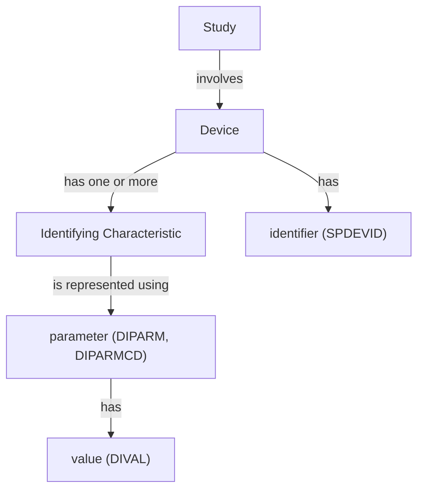
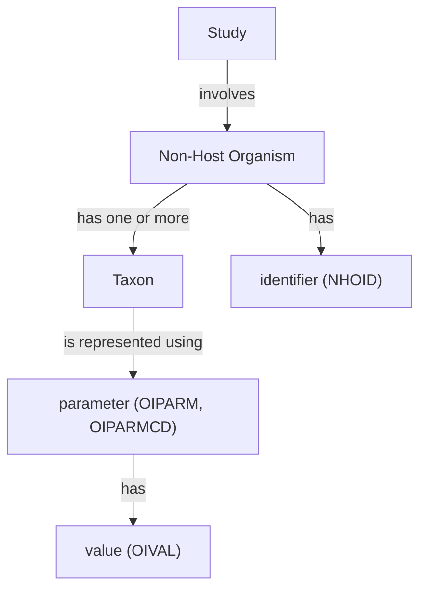

# SDTM v2.0 — Chapter 5: Study-level Data

Source: SDTM v2.0, Sections 5.1-5.2 (Pages 51-63)

## 5 Study-level Data

The SDTM includes 2 types of study-level data: trial design data and study reference data.

---

## 5.1 The Trial Design Model

The Trial Design Model defines a standard structure for representing the planned sequence of activities and the treatment plan for the trial. These include ways to represent:

- Planned treatment arms (Section 5.1.1, Trial Arms and Trial Elements)
- Planned groups of subjects (Section 5.1.2, Trial Sets)
- Planned sequences of reproductive stages (animal developmental and reproductive toxicology studies; Section 5.1.3, Trial Repro Stages and Trial Repro Paths)
- Planned schedules for activities and data collection (Section 5.1.4, Trial Planned Data Collection)
- Study eligibility criteria (Section 5.1.5, Trial Inclusion/Exclusion Criteria)
- Other aspects of a study, expressed as a series of parameters (Section 5.1.6, Trial Summary Information)
- Characteristics of a study challenge agent (Section 5.1.7, Challenge Agent Characterization)

Many Trial Design domains define study-specific terminology (e.g., for study arms, visits, and eligibility criteria), and variables and variable values from these domains are used in subject-level domains.

### 5.1.1 Trial Arms and Trial Elements

The Trial Arms dataset describes arms as sequences of trial elements, with trial elements described in the Trial Elements dataset.

#### 5.1.1.1 Trial Elements (TE)

Trial Elements describes the periods of times through which subjects pass in the course of a trial. The domain is identified by the domain code "TE".

**Trial Elements—One Record per Trial Element**

| # | Variable | Label | Type | Role |
|---|----------|-------|------|------|
| 1 | STUDYID | Study Identifier | Char | Identifier |
| 2 | DOMAIN | Domain Abbreviation | Char | Identifier |
| 3 | ETCD | Element Code | Char | Topic |
| 4 | ELEMENT | Description of Element | Char | Synonym Qualifier (ETCD) |
| 5 | TESTRL | Rule for Start of Element | Char | Rule |
| 6 | TEENRL | Rule for End of Element | Char | Rule |
| 7 | TEDUR | Planned Duration of Element | Char | Timing |

#### 5.1.1.2 Trial Arms (TA)

Trial Arms describes each planned arm in a trial. An arm is an ordered sequence of elements; the same element may occur more than once in a given arm. In order to accommodate complex trial designs, this dataset allows for rules for branching from one element to another when a choice is available, and a rule for transitions to allow a subject to skip ahead to another element rather than proceed linearly.

Note that although the same element may occur more than once within an arm, each occurrence would have a different value for TAETORD and EPOCH, and may have different values for TABRANCH and TATRANS.

**Trial Arms—One Record per Planned Element per Arm**

| # | Variable | Label | Type | Role |
|---|----------|-------|------|------|
| 1 | STUDYID | Study Identifier | Char | Identifier |
| 2 | DOMAIN | Domain Abbreviation | Char | Identifier |
| 3 | ARMCD | Planned Arm Code | Char | Topic |
| 4 | ARM | Description of Planned Arm | Char | Synonym Qualifier (ARMCD) |
| 5 | TAETORD | Planned Order of Element within Arm | Num | Timing |
| 6 | ETCD | Element Code | Char | Record Qualifier |
| 7 | ELEMENT | Description of Element | Char | Synonym Qualifier (ETCD) |
| 8 | TABRANCH | Branch | Char | Rule |
| 9 | TATRANS | Transition Rule | Char | Rule |
| 10 | EPOCH | Epoch | Char | Timing |

### 5.1.2 Trial Sets (TX)

Trial Sets allows the submission of detailed information about planned groups of subjects that results as a combination of experimental factors of interest for a study (including experimental parameters, inherent characteristics, and sponsor-defined attributes). A "set" may be a planned subdivision of a trial arm, or may comprise 1 or more trial arms. These datasets are essential to determining whether data comparisons are feasible across different studies.

**Trial Sets—One Record per Trial Set Parameter**

| # | Variable | Label | Type | Role |
|---|----------|-------|------|------|
| 1 | STUDYID | Study Identifier | Char | Identifier |
| 2 | DOMAIN | Domain Abbreviation | Char | Identifier |
| 3 | SETCD | Set Code | Char | Identifier |
| 4 | SET | Set Description | Char | Synonym Qualifier (SETCD) |
| 5 | TXSEQ | Sequence Number | Num | Identifier |
| 6 | TXPARMCD | Trial Set Parameter Short Name | Char | Topic |
| 7 | TXPARM | Trial Set Parameter | Char | Synonym Qualifier (TXPARMCD) |
| 8 | TXVAL | Trial Set Parameter Value | Char | Result Qualifier |

### 5.1.3 Trial Repro Stages and Trial Repro Paths

**Note:** Not for use with human clinical trials.

The Trial Repro Paths dataset describes the series of reproductive stages planned for study subjects. The reproductive stages are defined in the Trial Repro Stages dataset. These datasets are relevant only for studies in which reproductive stages are part of the study plan.

#### 5.1.3.1 Trial Repro Stages (TT)

**Note:** Not for use with human clinical trials.

Trial Repro Stages describes the unique repro stages in a study, with repro stage description, code (short name), and rules for start and end.

**Trial Repro Stages—One Record per Planned Repro Stage**

> KB note (not in SDTM v2.0): the table below adds only the PDF Usage Restrictions column to the 5 base columns; rows 3-7 carry its value ("Not in human clinical trials"). Exception: the DOMAIN cell "TT" is not a Usage Restrictions value (that PDF cell is blank); it condenses the PDF Notes column.

| # | Variable | Label | Type | Role | Usage Restrictions |
|---|----------|-------|------|------|--------------------|
| 1 | STUDYID | Study Identifier | Char | Identifier | |
| 2 | DOMAIN | Domain Abbreviation | Char | Identifier | "TT" |
| 3 | RSTGCD | Repro Stage Code | Char | Topic | Not in human clinical trials |
| 4 | RSTAGE | Description of Repro Stage | Char | Synonym Qualifier (RSTGCD) | Not in human clinical trials |
| 5 | TTSTRL | Rule for Start of Repro Stage | Char | Rule | Not in human clinical trials |
| 6 | TTENRL | Rule for End of Repro Stage | Char | Rule | Not in human clinical trials |
| 7 | TTDUR | Planned Duration of Repro Stage | Char | Timing | Not in human clinical trials |

#### 5.1.3.2 Trial Repro Paths (TP)

**Note:** Not for use with human clinical trials.

Trial Repro Paths describes each planned repro path in a repro study, with the ordered sequence of repro stages that comprise each repro path, as well as specification of repro phase and reference start day of the repro phase applicable to the repro stage within the repro path.

**Trial Repro Paths—One Record per Planned Repro Stage per Repro Path**

> KB note (not in SDTM v2.0): the table below adds only the PDF Usage Restrictions column to the 5 base columns; rows 3-10 carry its value ("Not in human clinical trials"). Exception: the DOMAIN cell "TP" is not a Usage Restrictions value (that PDF cell is blank); it condenses the PDF Notes column.

| # | Variable | Label | Type | Role | Usage Restrictions |
|---|----------|-------|------|------|--------------------|
| 1 | STUDYID | Study Identifier | Char | Identifier | |
| 2 | DOMAIN | Domain Abbreviation | Char | Identifier | "TP" |
| 3 | RPATHCD | Planned Repro Path Code | Char | Topic | Not in human clinical trials |
| 4 | RPATH | Description of Planned Repro Path | Char | Synonym Qualifier (RPATHCD) | Not in human clinical trials |
| 5 | TPSTGORD | Order of Repro Stage within Repro Path | Num | Timing | Not in human clinical trials |
| 6 | RSTGCD | Repro Stage Code | Char | Topic | Not in human clinical trials |
| 7 | RSTAGE | Description of Repro Stage | Char | Synonym Qualifier (RSTGCD) | Not in human clinical trials |
| 8 | TPBRANCH | Branch | Char | Rule | Not in human clinical trials |
| 9 | RPHASE | Repro Phase | Char | Timing | Not in human clinical trials |
| 10 | RPRFDY | Repro Phase Start Reference Day | Num | Timing | Not in human clinical trials |

### 5.1.4 Trial Planned Data Collection

The datasets in this section describe parts of a study's schedule of activities.

- Trial Visits describes planned clinical encounters at which activities are scheduled.
- Trial Disease Assessments describes schedules for disease assessments which are not easily expressed as taking place at visits.
- Trial Disease Milestones describes plans to collect data when triggered by the occurrence of particular anticipated events, findings, or activities, rather than at scheduled times.

#### 5.1.4.1 Trial Visits (TV)

Trial Visits describes the planned order and number of visits in the study. Trial Visits also describes the allowable or planned values for VISIT, VISITNUM, and VISITDY in the trial (which are subsequently used as timing variables for the collected study data), and rules for starting and ending each visit. In most blinded trials, the timing of visits is the same for all subjects in all arms. In the case where visits vary for each arm, there would be a separate record per visit per arm.

**Trial Visits—One Record per Planned Trial Visit**

| # | Variable | Label | Type | Role |
|---|----------|-------|------|------|
| 1 | STUDYID | Study Identifier | Char | Identifier |
| 2 | DOMAIN | Domain Abbreviation | Char | Identifier |
| 3 | VISITNUM | Visit Number | Num | Topic |
| 4 | VISIT | Visit Name | Char | Synonym Qualifier (VISITNUM) |
| 5 | VISITDY | Planned Study Day of Visit | Num | Timing |
| 6 | ARMCD | Planned Arm Code | Char | Record Qualifier |
| 7 | ARM | Description of Planned Arm | Char | Synonym Qualifier (ARMCD) |
| 8 | TVSTRL | Visit Start Rule | Char | Rule |
| 9 | TVENRL | Visit End Rule | Char | Rule |

#### 5.1.4.2 Trial Disease Assessments (TD)

Trial Disease Assessments provides information on the planned protocol-specified disease assessment schedule when those disease assessments cannot be expressed using Trial Visits.

In oncology studies, compliance with the disease-assessment schedule is essential to reduce the risk of assessment time bias. The TD domain makes possible an evaluation of assessment time bias from SDTM-based datasets by allowing comparison of the planned schedule of assessments against the actual occurrence of the efficacy assessments in order to determine the degree of compliance. TD has limited utility outside oncology (and indeed has limited utility within oncology studies). It was developed specifically with Response Evaluation Criteria in Solid Tumors (RECIST) in mind and, in particular, for studies with progression-free survival (PFS) endpoints where an assessment time bias analysis is appropriate.

**Trial Disease Assessments—One Record per Planned Constant Assessment Period**

| # | Variable | Label | Type | Role |
|---|----------|-------|------|------|
| 1 | STUDYID | Study Identifier | Char | Identifier |
| 2 | DOMAIN | Domain Abbreviation | Char | Identifier |
| 3 | TDORDER | Sequence of Planned Assessment Schedule | Num | Timing |
| 4 | TDANCVAR | Anchor Variable Name | Char | Timing |
| 5 | TDSTOFF | Offset from the Anchor | Char | Timing |
| 6 | TDTGTPAI | Planned Assessment Interval | Char | Timing |
| 7 | TDMINPAI | Planned Assessment Interval Minimum | Char | Timing |
| 8 | TDMAXPAI | Planned Assessment Interval Maximum | Char | Timing |
| 9 | TDNUMRPT | Maximum Number of Actual Assessments | Num | Record Qualifier |

#### 5.1.4.3 Trial Disease Milestones (TM)

Trial Disease Milestones is used to describe observations or activities expected to occur in the course of the disease under study, the timing of which is of interest for the study.

**Trial Disease Milestones—One Record per Disease Milestone Type**

| # | Variable | Label | Type | Role |
|---|----------|-------|------|------|
| 1 | STUDYID | Study Identifier | Char | Identifier |
| 2 | DOMAIN | Domain Abbreviation | Char | Identifier |
| 3 | MIDSTYPE | Disease Milestone Type | Char | Topic |
| 4 | TMDEF | Disease Milestone Definition | Char | Variable Qualifier (MIDSTYPE) |
| 5 | TMRPT | Disease Milestone Repetition Indicator | Char | Record Qualifier |

### 5.1.5 Trial Inclusion/Exclusion Criteria (TI)

Trial Inclusion/Exclusion contains 1 record for each of the inclusion and exclusion criterion for the trial. If eligibility criteria change during a trial, each version of the eligibility criteria may be represented.

**Trial Inclusion/Exclusion—One Record per Trial Inclusion or Exclusion Criterion**

| # | Variable | Label | Type | Role |
|---|----------|-------|------|------|
| 1 | STUDYID | Study Identifier | Char | Identifier |
| 2 | DOMAIN | Domain Abbreviation | Char | Identifier |
| 3 | IETESTCD | Inclusion/Exclusion Criterion Short Name | Char | Topic |
| 4 | IETEST | Inclusion/Exclusion Criterion | Char | Synonym Qualifier (IETESTCD) |
| 5 | IECAT | Inclusion/Exclusion Category | Char | Grouping Qualifier |
| 6 | IESCAT | Inclusion/Exclusion Subcategory | Char | Grouping Qualifier |
| 7 | TIRL | Inclusion/Exclusion Criterion Rule | Char | Rule |
| 8 | TIVERS | Protocol Criteria Versions | Char | Record Qualifier |

### 5.1.6 Trial Summary Information (TS)

Trial Summary Information contains 1 record for each trial summary characteristic. Trial Summary is used to record basic information about the trial (e.g., trial phase, protocol title, design objectives).

**Trial Summary—One Record per Trial Summary Parameter**

> KB note (not in SDTM v2.0): the table below adds only the PDF Usage Restrictions column to the 5 base columns; rows 9-11 carry its value ("Not in nonclinical trials"); the other rows are blank in that PDF column.

| # | Variable | Label | Type | Role | Usage Restrictions |
|---|----------|-------|------|------|--------------------|
| 1 | STUDYID | Study Identifier | Char | Identifier | |
| 2 | DOMAIN | Domain Abbreviation | Char | Identifier | |
| 3 | TSSEQ | Sequence Number | Num | Identifier | |
| 4 | TSGRPID | Group ID | Char | Identifier | |
| 5 | TSPARMCD | Trial Summary Parameter Short Name | Char | Topic | |
| 6 | TSPARM | Trial Summary Parameter | Char | Synonym Qualifier (TSPARMCD) | |
| 7 | TSVAL | Parameter Value | Char | Result Qualifier | |
| 8 | TSVALNF | Parameter Null Flavor | Char | Result Qualifier | |
| 9 | TSVALCD | Parameter Value Code | Char | Result Qualifier | Not in nonclinical trials |
| 10 | TSVCDREF | Name of the Reference Terminology | Char | Result Qualifier | Not in nonclinical trials |
| 11 | TSVCDVER | Version of the Reference Terminology | Char | Result Qualifier | Not in nonclinical trials |

### 5.1.7 Challenge Agent Characterization (AC)

The Challenge Agent Characterization dataset allows the sponsor to provide information about challenge agents used in a trial in a structured format. Each record in the Challenge Agent Characterization dataset contains a parameter (a characteristic of the challenge agent) and its value.

**Challenge Agent Characterization—One Record per Challenge Agent Characterization Parameter Instance**

| # | Variable | Label | Type | Role |
|---|----------|-------|------|------|
| 1 | STUDYID | Study Identifier | Char | Identifier |
| 2 | DOMAIN | Domain Abbreviation | Char | Identifier |
| 3 | ACSEQ | Sequence Number | Num | Identifier |
| 4 | ACGRPID | Group ID | Char | Identifier |
| 5 | ACPARMCD | Challenge Agent Parameter Short Name | Char | Topic |
| 6 | ACPARM | Challenge Agent Parameter | Char | Synonym Qualifier (ACPARMCD) |
| 7 | ACVAL | Parameter Value | Char | Result Qualifier |
| 8 | ACVALU | Parameter Units | Char | Variable Qualifier (ACVAL) |
| 9 | ACVALNF | Parameter Null Flavor | Char | Result Qualifier |
| 10 | ACVALCD | Parameter Value Code | Char | Result Qualifier |
| 11 | ACVCDREF | Name of the Reference Terminology | Char | Result Qualifier |
| 12 | ACVCDVER | Version of the Reference Terminology | Char | Result Qualifier |

---

## 5.2 Study References

There are occasions when it is necessary to establish study-specific identifiers that will be used in subject data. Two such situations have been identified thus far:

- Identifiers for devices
- Identifiers for non-host organisms

### 5.2.1 Device Identifiers Dataset (DI)

> KB note (not in SDTM v2.0): **Structure:** One record per device attribute per device

The identity of a device is established by means of a number of parameters, then assigned an identifier. The parameters used for identification of a device depend on the kind of device and the need of the study to distinguish among devices.

**Device Identifiers Dataset**

| # | Variable | Label | Type | Role |
|---|----------|-------|------|------|
| 1 | STUDYID | Study Identifier | Char | Identifier |
| 2 | DOMAIN | Domain Abbreviation | Char | Identifier |
| 3 | SPDEVID | Sponsor Device Identifier | Char | Identifier |
| 4 | DISEQ | Sequence Number | Num | Identifier |
| 5 | DIPARMCD | Device Identifier Element Short Name | Char | Topic |
| 6 | DIPARM | Device Identifier Element Name | Char | Synonym Qualifier (DIPARMCD) |
| 7 | DIVAL | Device Identifier Element Value | Char | Result Qualifier |

**Concept Map. Relationships Between Device Identifier Variables**

> KB note (not in SDTM v2.0): Mermaid rendering of the PDF figure "Concept Map. Relationships Between Device Identifier Variables" (p62).

### 5.2.2 Non-host Organism Identifiers Dataset (OI)

> KB note (not in SDTM v2.0): **Structure:** One record per taxon per non-host organism

The identity of a non-host organism is established by means of a number of *taxa* (categories used to classify living things), then assigned an identifier. The taxa used for identification of a non-host organism depend on the kind of organism and the needs of the study to distinguish among organisms.

**Non-host Organism Identifiers Dataset**

| # | Variable | Label | Type | Role |
|---|----------|-------|------|------|
| 1 | STUDYID | Study Identifier | Char | Identifier |
| 2 | DOMAIN | Domain Abbreviation | Char | Identifier |
| 3 | NHOID | Non-Host Organism Identifier | Char | Identifier |
| 4 | OISEQ | Sequence Number | Num | Identifier |
| 5 | OIPARMCD | Non-Host Organism ID Element Short Name | Char | Topic |
| 6 | OIPARM | Non-Host Organism ID Element Name | Char | Synonym Qualifier (OIPARMCD) |
| 7 | OIVAL | Non-Host Organism ID Element Value | Char | Result Qualifier |

**Concept Map. Relationships Between Non-host Organism Identifier Variables**

> KB note (not in SDTM v2.0): Mermaid rendering of the PDF figure "Concept Map. Relationships Between Non-host Organism Identifier Variables" (p63).

